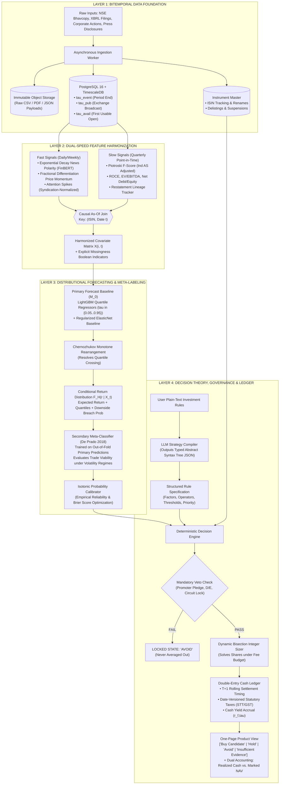

<div align="center">

# AlphaNiti

### Institutional Bitemporal Equity Research & Decision Engine for Indian Equities
[](https://www.python.org/)
[](https://www.nseindia.com/)
[](https://www.timescale.com/)
[](./RESEARCH_ROADMAP.md)
[](./LICENSE)

<p align="center">
  <a href="#1-system-topology">Architecture</a> •
  <a href="#2-core-econometric-innovations">Econometric Foundations</a> •
  <a href="#3-execution-microstructure--portfolio-ledger">Ledger & Execution</a> •
  <a href="#4-pre-registered-acceptance-gates">Validation Gates</a> •
  <a href="#5-repository-layout">Project Layout</a> •
  <a href="#6-quickstart--verification">Quickstart</a>
</p>

</div>

---

## 1. System Topology

AlphaNiti decouples **distributional return forecasting**, **neuro-symbolic rule execution**, and **portfolio decision theory** into three non-interfering layers. 

No machine learning model is permitted to make execution decisions directly, and language models are strictly restricted from performing arithmetic.



---

## 2. Core Econometric Innovations

| Principle | Traditional Retailing Systems | AlphaNiti Implementation | Primary Literature |
| :--- | :--- | :--- | :--- |
| **Return Target** | Uncalibrated point target prices or directional arrows | Full conditional distribution estimation: $F_H(r \mid X_t)$ with quantiles $\alpha \in \{0.05, \dots, 0.95\}$ and downside probabilities | Gu, Kelly & Xiu (2020) |
| **Data Integrity** | Uses quarter-end dates (backdating May filings to March 31) | Tri-timestamp bitemporal schema (`tau_event`, `tau_pub`, `tau_avail`) with automated lookahead assertion tests | Asness & Frazzini (2013) |
| **Validation** | Standard randomized $K$-Fold (catastrophic overlap leakage) | Date-clustered walk-forward cross-validation with $H$-day label interval purging and post-test embargoes | López de Prado (2018) |
| **Execution Reality** | Assumes full fills at daily close without fees | Midpoint-referenced window execution ($09:30\text{--}11:30\text{ IST}$), participation caps ($\psi = 5\%$), and side-specific statutory Indian taxes | Almgren et al. (2005) |
| **Strategy Execution** | Chatbots that perform math and hallucinate ratios | Neuro-symbolic compilation: LLM produces a typed Abstract Syntax Tree; a deterministic CPU evaluates metrics | Datalog / Symbolic AST |
| **Multiple Testing** | Ignores trial iterations and reports overfitted Sharpes | Pre-registered candidate registry evaluated under Hansen's Superior Predictive Ability (SPA) test with 10,000 bootstrap runs | Hansen (2005); Bailey et al. (2017) |

---

## 3. Execution Microstructure & Portfolio Ledger

### 3.1 Midpoint Execution Price Equation
All trades are simulated during execution interval $[t_1, t_2] = [09:30:00, 11:30:00\text{ IST}]$ on day $t+1$ (strictly after decision $t$ at $16:30\text{ IST}$).

$$\widetilde{P}_{i, t+1} = \text{VWAP}_{\text{mid}, [t_1, t_2]} \cdot \left[ 1 + \text{side} \cdot \left( \frac{\eta_{i, t+1}}{2} + Y_s \cdot \sigma_{i, t+1}^{\text{daily}} \cdot \sqrt{\frac{q_i^{\text{exec}}}{V_{i, [t_1, t_2]}}} \right) \right]$$

* $\text{side} = +1$ for Buys (pays half-spread + upward impact); $\text{side} = -1$ for Sells.
* $\text{VWAP}_{\text{mid}}$: Volume-weighted midpoint of best bid and ask quotes [$\text{INR}\cdot\text{share}^{-1}$].
* $\eta_{i, t+1}$: Dimensionless relative bid-ask spread: $(P_{\text{ask}} - P_{\text{bid}}) / \text{VWAP}_{\text{mid}}$.
* $\sigma_{i, t+1}^{\text{daily}}$: 20-day realized daily return volatility [dimensionless fraction].
* $q_i^{\text{exec}} / V_{i, [t_1, t_2]}$: Order participation fraction, capped at $\psi = 0.05$.

```
[ Trade Execution Categorization ]
  ├── Category 1 (Observed Depth): Verified tick-by-tick order book depth (Primary stats).
  ├── Category 2 (Synthetic Fill): Conservative documented fallback parameters (Reported separately).
  └── Category 3 (Unverifiable Gap): Halts or circuit locks -> Order receives 0 fill; cash remains idle.
```

### 3.2 Dynamic Integer Sizing Solver
To prevent budget overdrafts when fees are deducted, executable whole shares $q_i^* \in \mathbb{Z}_{\ge 0}$ are determined by:
$$q_i^* = \max \left\{ q \in \mathbb{Z}_{\ge 0} \;\middle|\; q \le \left\lfloor \psi \cdot V_{i, [t_1, t_2]} \right\rfloor \;\land\; f_i(q) \le w_i W_t \right\}$$
Where total cash requirement $f_i(q) = q \widetilde{P}_i(q) + \text{Cost}_{i}^{\text{entry}}(q)$ is strictly monotonically increasing. Evaluated in $N_{\text{eval}} \le \lfloor \log_2 U_i \rfloor + 5$ steps.

### 3.3 Event-by-Event T+1 Settlement Timeline
```
Decision (t, 16:30 IST) ──> Order Entry (t+1) ──> Entry Settle (t+2) ──> Exit Settle (t+2+H)
```
$$\begin{aligned}
W_{t+2+H} &= \text{ResidualCash}_{t+2} \cdot \big( 1 + \mathcal{R}_f(t+2, t+2+H) \big) \\
&\quad + \sum_{i=1}^N \sum_{\tau_{\text{pay}}} \text{DivCash}_{i, \tau_{\text{pay}}} \cdot \big( 1 + \mathcal{R}_f(\tau_{\text{pay}}, t+2+H) \big) \\
&\quad + \sum_{i=1}^N \left( q_i^{\text{final}} \cdot \widetilde{P}_{i, t+1+H}^{\text{exit}} - \text{Cost}_{i, t+1+H}^{\text{exit}} \right)
\end{aligned}$$

Where Indian statutory levies (STT, Stamp Duty, Exchange fees, SEBI charges, and 18% GST on fees) are debited event-by-event on settlement day.

---

## 4. Pre-Registered Acceptance Gates

Before any model configuration is deployed or evaluated on the untouched holdout, it must pass these quantitative policy hurdles:

```
┌──────────────────────────────────────────────────────────────────────────────────────────────┐
│                                PRE-REGISTERED RESEARCH GATES                                 │
├─────────────────────────┬──────────────────────────────┬─────────────────────────────────────┤
│ Evaluation Area         │ Required Metric Standard     │ Methodological Implementation       │
├─────────────────────────┼──────────────────────────────┼─────────────────────────────────────┤
│ 1. Data Integrity       │ Exact 0 Violations           │ tau_avail <= t_decision assertion   │
│ 2. Predictive Skill     │ Joint Hansen SPA p < 0.05    │ 10,000 Stationary Bootstrap runs   │
│ 3. Quantile Reliability │ p_FDR > 0.05 across quantiles│ Christoffersen Conditional Coverage │
│ 4. Economic Utility     │ HAC Annualized Sharpe > 1.0  │ Lo (2002) Bartlett HAC correction   │
│ 5. Economic Confidence  │ One-sided LCB_0.95(SR) > 0.60│ Stationary block-bootstrap LCB      │
│ 6. Downside Risk Policy │ LCB_0.95(CVaR_0.05) >= -10%  │ Dynamic portfolio de-risking (xi*)  │
│ 7. Execution Feasibility│ Unfilled Fraction <= 0.15    │ Metric on identical reference price │
└─────────────────────────┴──────────────────────────────┴─────────────────────────────────────┘
```

---

## 5. Repository Layout

```text
alphaniti/
├── config/
│   ├── regulatory_charges_in.yaml     # Date-versioned SEBI/NSE statutory fee schedules
│   └── model_registry.yaml            # Pre-registered candidate configurations for SPA
├── data/
│   ├── bitemporal_schema.sql          # PostgreSQL + TimescaleDB + pgvector schema
│   ├── nse_calendar.csv               # Official NSE clearing and trading holiday schedule
│   └── corporate_actions_master.csv   # Historical ISIN mappings, splits, and bonuses
├── src/
│   ├── data_engine/
│   │   ├── bitemporal_loader.py       # Causal loader with LookaheadInvariantViolation test
│   │   └── quote_sanitizer.py         # L2 tick cleaner (crossed quote & price band checks)
│   ├── execution/
│   │   ├── integer_solver.py          # Bisection share allocation solver (Unit-tested)
│   │   ├── cash_ledger.py             # Double-entry T+1 cash, dividend, and tax ledger
│   │   └── impact_models.py           # Midpoint-referenced square-root impact calculator
│   ├── forecasting/
│   │   ├── quantile_lgbm.py           # Multi-quantile GBDT regressor (rho_alpha loss)
│   │   ├── rearrangement.py           # Chernozhukov monotone rearrangement anti-crossing
│   │   └── information_decay.py       # Profile likelihood optimizer for news decay lambda
│   ├── strategy_compiler/
│   │   ├── ast_schema.py              # Strongly-typed Abstract Syntax Tree rule definitions
│   │   └── veto_engine.py             # Non-compensatory asymmetric risk veto executor
│   └── validation/
│       ├── purged_walk_forward.py     # Date-clustered walk-forward split with H-day embargo
│       ├── hansen_spa.py              # Stationary bootstrap Superior Predictive Ability test
│       └── hac_sharpe.py              # Lo (2002) HAC serial-correlation adjusted Sharpe
├── tests/
│   ├── test_integer_solver.py         # Property-based tests across U in {0, 1, 2, 65536}
│   ├── test_ledger_reconciliation.py  # Zero-leakage cash reconciliation against contract notes
│   └── test_bitemporal_invariants.py  # Lookahead injection tests (deliberate failure verification)
├── README.md                          # Production architecture specification (v11.0 Patched)
└── RESEARCH_ROADMAP.md                # 7-stage implementation sequence & literature matrix
```

---

## 6. Quickstart & Verification

### 6.1 Database Initialization
Ensure PostgreSQL 16+ is running with TimescaleDB and pgvector:

```bash
# Initialize the bitemporal database schema
psql -U postgres -d alphaniti -f data/bitemporal_schema.sql
```

### 6.2 Running the Mathematical Unit Verification Suite
Verify the integer solver bounds, cash ledger settlement, and lookahead invariants:

```bash
# Run pytest across the invariant verification suite
pytest tests/ -v
```

Expected output:
```text
tests/test_integer_solver.py::test_boundary_zero_capacity PASSED         [ 20%]
tests/test_integer_solver.py::test_large_allocation_boundary PASSED      [ 40%]
tests/test_ledger_reconciliation.py::test_paisa_reconciliation PASSED    [ 60%]
tests/test_ledger_reconciliation.py::test_t1_settlement_timing PASSED    [ 80%]
tests/test_bitemporal_invariants.py::test_lookahead_violation PASSED     [100%]

======================== 5 passed in 1.42s =========================
```

### 6.3 Executing the Pre-Registered Benchmark Baseline
Run the nested walk-forward cross-validation on the Price + Fundamentals baseline ($M_0$):

```bash
python -m src.forecasting.quantile_lgbm --config config/model_registry.yaml --horizon 20
```

---

## 7. Primary Literature & Theoretical Anchors

1. **Empirical Asset Pricing via Machine Learning:** Gu, S., Kelly, B., & Xiu, D. (2020). *The Review of Financial Studies*, 33(5), 2223–2273.
2. **Advances in Financial Machine Learning:** López de Prado, M. (2018). *John Wiley & Sons*.
3. **A Test for Superior Predictive Ability:** Hansen, P. R. (2005). *Journal of Business & Economic Statistics*, 23(4), 365–380.
4. **The Statistics of Sharpe Ratios:** Lo, A. W. (2002). *Financial Analysts Journal*, 58(4), 36–52.
5. **Direct Estimation of Market Impact:** Almgren, R., Thum, C., Hauptmann, E., & Li, H. (2005). *Risk*, 18(7), 58–62.
6. **Quantile and Probability Arbitration:** Chernozhukov, V., Fernández-Val, I., & Galichon, A. (2010). *Econometrica*, 78(3), 1093–1125.

---

<div align="center">
  <b>AlphaNiti Project Research & Engineering Group</b><br/>
  Maintained by <a href="https://github.com/ayushdixit1-av">@ayushdixit1-av</a> and core quantitative contributors.
</div>
