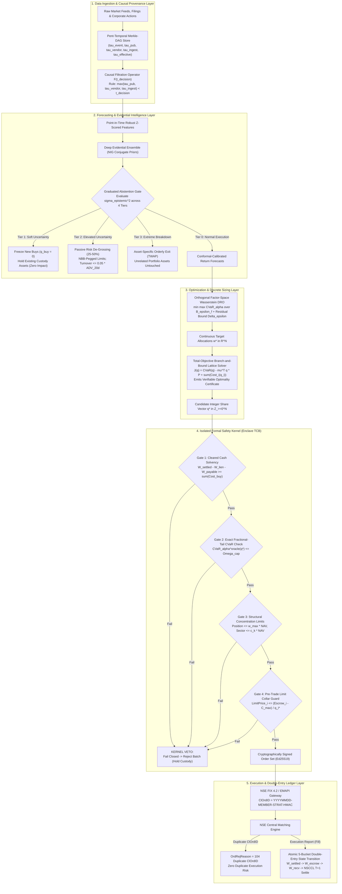
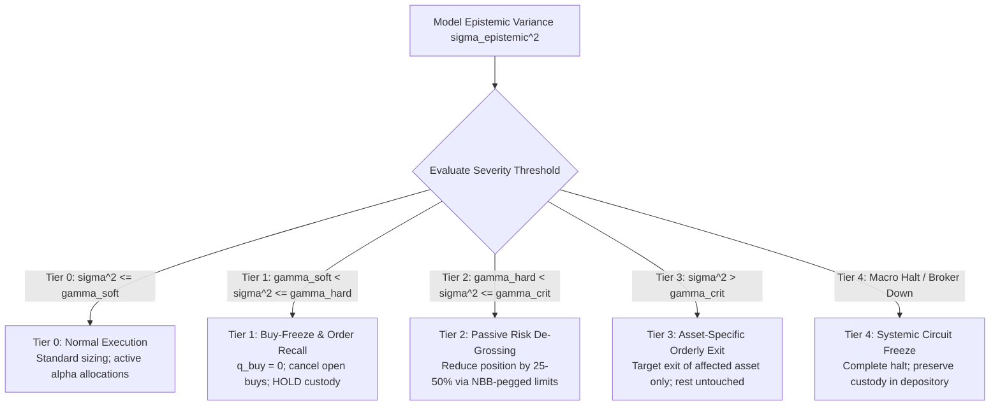
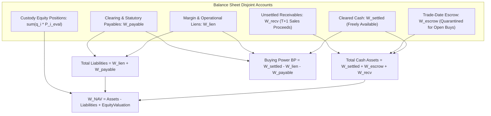
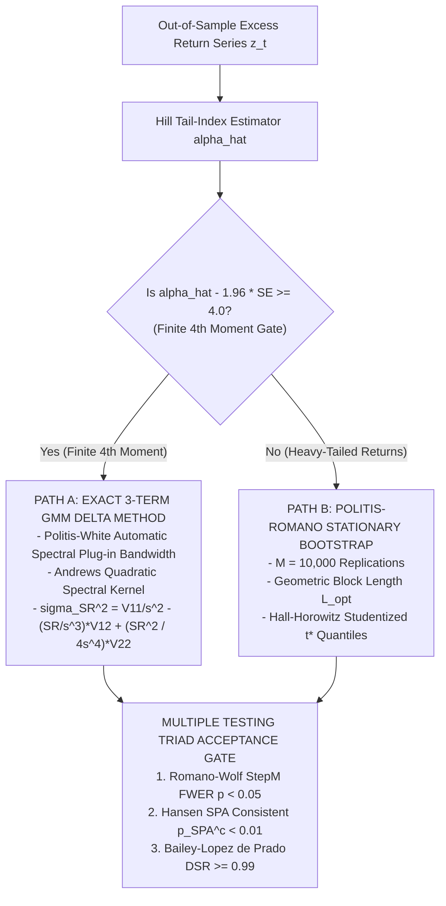

# AlphaNiti v25.0 — Quantitative Research, Distributionally Robust Optimization & Execution Architecture

**Point-in-Time Causal Data Engine, Evidential Uncertainty Decomposition, Factor-Space Wasserstein DRO, Discrete Branch-and-Bound Sizing & Conserved Double-Entry Ledger**  
*Formal Mathematical Specifications, TLA+ Safety Invariants, and Falsifiable Empirical Validation Protocols for Indian Equities (NSE / BSE)*

[](https://opensource.org/licenses/Apache-2.0)
[](#2-end-to-end-system-topology--modular-specification-index)
[](formal_specs/AlphaNitiSafetyKernel.tla)
[](docs/05_EXECUTION_ENGINE_AND_EXCHANGE_PROTOCOLS.md)
[](docs/09_RISK_REPORTING_AND_REGULATORY_AUDIT.md)
[](RESEARCH_ROADMAP.md)

---

## Table of Contents

1. [Executive Summary & Epistemic Verification Matrix](#1-executive-summary--epistemic-verification-matrix)
2. [End-to-End System Topology & Modular Specification Index](#2-end-to-end-system-topology--modular-specification-index)
3. [Pillar 1: Causal Pent-Temporal Data Model & Point-in-Time Filtration](#3-pillar-1-causal-pent-temporal-data-model--point-in-time-filtration)
4. [Pillar 2: Evidential Bayesian Ensembles & 4-Tiered Graduated Abstention](#4-pillar-2-evidential-bayesian-ensembles--4-tiered-graduated-abstention)
5. [Pillar 3: Factor-Space Wasserstein DRO & Fournier–Guillin Concentration](#5-pillar-3-factor-space-wasserstein-dro--fournierguillin-concentration)
6. [Pillar 4: Total-Objective Branch-and-Bound Lattice Sizing & Optimality Certificates](#6-pillar-4-total-objective-branch-and-bound-lattice-sizing--optimality-certificates)
7. [Pillar 5: Conserved Five-Bucket Double-Entry Ledger State Machine](#7-pillar-5-conserved-five-bucket-double-entry-ledger-state-machine)
8. [Pillar 6: Isolated Formal Safety Kernel & TLA+ Specification](#8-pillar-6-isolated-formal-safety-kernel--tla-specification)
9. [Pillar 7: Exchange Protocol Integration (NSE EMAPI / FIX 4.2)](#9-pillar-7-exchange-protocol-integration-nse-emapi--fix-42)
10. [Pillar 8: Date-Effective Indian Statutory Tax Matrix (Finance Act 2026)](#10-pillar-8-date-effective-indian-statutory-tax-matrix-finance-act-2026)
11. [Pillar 9: Calibration Testing, Econometric Inference & Multiple Testing Triad](#11-pillar-9-calibration-testing-econometric-inference--multiple-testing-triad)
12. [Literature Anchoring & Epistemic Demarcation (What Is Proved vs. Empirical Hypotheses)](#12-literature-anchoring--epistemic-demarcation-what-is-proved-vs-empirical-hypotheses)
13. [Master Proof-Obligation & Falsifiability Register (PO-1 through PO-12)](#13-master-proof-obligation--falsifiability-register-po-1-through-po-12)
14. [Repository Structure & Verification Commands](#14-repository-structure--verification-commands)
15. [License & Governance Framework](#15-license--governance-framework)

---

## 1. Executive Summary & Epistemic Verification Matrix

**AlphaNiti v25.0** is a formal quantitative research, distributionally robust portfolio construction, and safety-isolated trade execution specification engineered for the Indian cash equity and derivatives markets (National Stock Exchange of India — NSE / BSE).

Quantitative trading architectures frequently fail between backtest and production due to five structural defects:
1. **Point-in-Time Leakage**: Joining fundamental restatements or corporate disclosures on event dates rather than public broadcast and ingestion timestamps.
2. **Conflated Uncertainty**: Treating irreducible market volatility (aleatoric noise) identically to model unfamiliarity (epistemic risk), or triggering indiscriminate market-order liquidations during regime breaks.
3. **High-Dimensional DRO Degeneracy**: Applying Wasserstein Distributionally Robust Optimization (DRO) directly in $N$-dimensional asset space, where the concentration radius scales as $\mathcal{O}(S^{-1/N})$, reducing the optimizer to a trivial $1/N$ allocation.
4. **Heuristic Share Rounding**: Rounding continuous weights $\mathbf{w}^{\star} \in \mathbb{R}^N$ to discrete shares $\mathbf{q} \in \mathbb{Z}_{\ge 0}^N$ post-hoc, violating cash solvency and distorting non-convex tiered fee schedules.
5. **Unmonitored Cash Accounting**: Treating cash as a single scalar rather than a conserved double-entry state machine across cleared cash, trade-date escrow, $T+1$ receivables, liens, and statutory payables.

### Epistemic Discipline: No Unverified Claims

In accordance with institutional research governance ([`RESEARCH_ROADMAP.md`](RESEARCH_ROADMAP.md) and [`validation_report.md`](validation_report.md)), this repository enforces a strict demarcation between **analytical mathematical proofs**, **formal state-machine specifications**, **statutory schedules**, and **empirical hypotheses requiring out-of-sample falsification**. No self-assigned ratings or unsubstantiated performance claims are made; every architectural component is governed by explicit verification artifacts and falsifiable acceptance criteria:

| Architectural Pillar | Core Mechanism | Primary Repository Artifact | Epistemic Verification Class | Falsifiable Acceptance / Proof Criterion |
| :--- | :--- | :--- | :---: | :--- |
| **1. Causal Data Engine** | Pent-temporal tuple $\vec{\boldsymbol{\tau}}$ & filtration $\mathcal{F}_{t_{\text{decision}}}$ | [`docs/01_DATA_INGESTION_AND_TEMPORAL_MODEL.md`](docs/01_DATA_INGESTION_AND_TEMPORAL_MODEL.md) | **Analytical Definition & Invariant** | Future-record mutation test ($t_{\text{ingest}} \ge t_{\text{decision}}$) yields $\Delta \mathbf{q}_t^{\star} = \mathbf{0}$ |
| **2. Evidential Forecasting** | NIG conjugate posterior & 4-tier graduated abstention | [`docs/02_FORECASTING_AND_EVIDENTIAL_DEEP_ENSEMBLE.md`](docs/02_FORECASTING_AND_EVIDENTIAL_DEEP_ENSEMBLE.md) | **Closed-Form Derivation + Empirical Gate** | Exact Student-$t$ variance decomposition; out-of-fold Brier score & Kupiec/Christoffersen coverage $p > 0.05$ |
| **3. Factor-Space DRO Risk** | Orthogonal factor DRO ($k \le 5$) + residual CVaR bound $\Delta_\epsilon$ | [`docs/03_RISK_MODEL_AND_WASSERSTEIN_DRO.md`](docs/03_RISK_MODEL_AND_WASSERSTEIN_DRO.md) | **Analytical Proof (Fournier–Guillin 2015)** | Sub-additivity bound $\text{CVaR}_\alpha(\mathbf{w}) \le \text{CVaR}_\alpha^{\text{DRO}}(\mathbf{v}^T \mathbf{f}) + \Delta_\epsilon(\mathbf{w}, \alpha)$ |
| **4. Discrete Lattice Sizing** | Total-objective B&B with lower convex fee envelopes | [`docs/04_PORTFOLIO_OPTIMIZATION_AND_DISCRETE_SIZING.md`](docs/04_PORTFOLIO_OPTIMIZATION_AND_DISCRETE_SIZING.md) | **Analytical Proof (Rockafellar–Uryasev)** | Node lower bound $z_{\text{LP}}(\mathcal{N}) \le \min_{\mathbf{q} \in \mathbb{Z}^N \cap [\mathbf{l}, \mathbf{u}]} J(\mathbf{q})$; optimality gap $\le 10^{-6}$ |
| **5. Exchange Protocol** | HMAC `ClOrdID`, duplicate reject (Tag 104), 2PC WAL recovery | [`docs/05_EXECUTION_ENGINE_AND_EXCHANGE_PROTOCOLS.md`](docs/05_EXECUTION_ENGINE_AND_EXCHANGE_PROTOCOLS.md) | **Protocol Specification (NSE FIX 4.2)** | Zero duplicate order re-transmission prior to `OrderStatusRequest (35=H)` reconciliation |
| **6. Double-Entry Ledger** | 5-bucket state machine & pre-trade limit-price collar guard | [`docs/06_ACCOUNTING_NAV_AND_DOUBLE_ENTRY_LEDGER.md`](docs/06_ACCOUNTING_NAV_AND_DOUBLE_ENTRY_LEDGER.md) | **Inductive Mathematical Proof** | $\Delta W_k^{\text{NAV}} = \Delta \text{UnrealizedPnL}_k + \text{RealizedPnL}_k - \text{Charges}_k$; $W_k^{\text{settled}} \ge 0$ |
| **7. Econometric Validation** | Purged Walk-Forward, CPCV, Hill tail router, StepM / SPA / DSR | [`docs/07_MONITORING_VALIDATION_AND_CALIBRATION_TESTING.md`](docs/07_MONITORING_VALIDATION_AND_CALIBRATION_TESTING.md) | **Empirical Falsification Protocol** | Simultaneously pass $p_{\text{StepM}} < 0.05$, $p_{\text{SPA}}^c < 0.01$, and $\text{DSR} \ge 0.99$ on untouched holdouts |
| **8. Isolated Safety Kernel** | Hardware/OS memory locking, syscall filtering & TLA+ model | [`docs/08_PLATFORM_SECURITY_AND_ISOLATED_SAFETY_KERNEL.md`](docs/08_PLATFORM_SECURITY_AND_ISOLATED_SAFETY_KERNEL.md)<br/>[`formal_specs/AlphaNitiSafetyKernel.tla`](formal_specs/AlphaNitiSafetyKernel.tla) | **Formal State-Machine Specification** | TLC invariant verification of `TypeOK`, `SolvencyInvariant`, and `NonNegativeBalancesInvariant` |
| **9. Tax & Regulatory Audit** | Finance Act 2026 statutory matrix & SEBI OTR throttle | [`docs/09_RISK_REPORTING_AND_REGULATORY_AUDIT.md`](docs/09_RISK_REPORTING_AND_REGULATORY_AUDIT.md) | **Statutory & Regulatory Schedule** | Exact match against NSE/SEBI circular fee formulas and Finance Act 2026 STT rates |

---

## 2. End-to-End System Topology & Modular Specification Index



### Modular Pipeline Documentation & Literature Register

Every stage of the pipeline is documented in a dedicated specification file inside [`docs/`](docs/), alongside the repository's methodology and feasibility audit guides:

| Document | Architectural Scope & Mathematical Contents | Primary Literature & Standards |
| :--- | :--- | :--- |
| [`docs/01_DATA_INGESTION_AND_TEMPORAL_MODEL.md`](docs/01_DATA_INGESTION_AND_TEMPORAL_MODEL.md) | 5-timestamp vector $\vec{\boldsymbol{\tau}}$, strict causal filtration $\mathcal{F}_{t_{\text{decision}}}$, exact split/bonus/rights/dividend adjustments, MAD robust Z-scoring | López de Prado (2018), Asness et al. (2014), Brown et al. (1992) |
| [`docs/02_FORECASTING_AND_EVIDENTIAL_DEEP_ENSEMBLE.md`](docs/02_FORECASTING_AND_EVIDENTIAL_DEEP_ENSEMBLE.md) | Normal-Inverse-Gamma (NIG) conjugate updates, exact Student-$t$ aleatoric/epistemic decomposition, split-conformal quantile calibration, 4-tier abstention | Amini et al. (NeurIPS 2020), Lakshminarayanan et al. (2017), Angelopoulos & Bates (2021) |
| [`docs/03_RISK_MODEL_AND_WASSERSTEIN_DRO.md`](docs/03_RISK_MODEL_AND_WASSERSTEIN_DRO.md) | Factor-residual decomposition, full residual covariance $\boldsymbol{\Sigma}_\epsilon$, sub-Gaussian & empirical residual CVaR bounds $\Delta_\epsilon$, Fournier–Guillin radius $\epsilon_f$, Esfahani–Kuhn LP dual | Fournier & Guillin (2015), Esfahani & Kuhn (2018), Rockafellar & Uryasev (2000), Ledoit & Wolf (2004) |
| [`docs/04_PORTFOLIO_OPTIMIZATION_AND_DISCRETE_SIZING.md`](docs/04_PORTFOLIO_OPTIMIZATION_AND_DISCRETE_SIZING.md) | Total-objective integer program $J(\mathbf{q})$, lower convex fee envelopes $\text{Cost}_i^{\text{cvx}}(q_i)$, valid B&B node lower bounds, optimality certificate schema | Rockafellar & Uryasev (2002), Bertsimas & Shioda (2009), Almgren & Chriss (2000) |
| [`docs/05_EXECUTION_ENGINE_AND_EXCHANGE_PROTOCOLS.md`](docs/05_EXECUTION_ENGINE_AND_EXCHANGE_PROTOCOLS.md) | NSE EMAPI / FIX 4.2 session state machine, HMAC `ClOrdID` uniqueness, Tag 104 / Code 16384 duplicate rejection, 2-phase commit WAL crash recovery | NSE EMAPI Spec, FIX 4.2 Protocol Standard, Aldridge (2013) |
| [`docs/06_ACCOUNTING_NAV_AND_DOUBLE_ENTRY_LEDGER.md`](docs/06_ACCOUNTING_NAV_AND_DOUBLE_ENTRY_LEDGER.md) | Disjoint 5-bucket balance sheet, inductive NAV conservation proof across all transitions, decoupled buying power vs. NAV, pre-trade limit collar guard | IFRS 9 / Ind AS 32, Dijkstra (1975), Lamport (2002) |
| [`docs/07_MONITORING_VALIDATION_AND_CALIBRATION_TESTING.md`](docs/07_MONITORING_VALIDATION_AND_CALIBRATION_TESTING.md) | Kupiec $\text{LR}_{\text{uc}}$ & Christoffersen $\text{LR}_{\text{ind}}$ calibration tests, Purged/Embargoed CV, Hill tail index router, Romano–Wolf StepM, Hansen SPA, Bailey DSR | Christoffersen (1998), Kupiec (1995), Romano & Wolf (2005), Hansen (2005), Bailey & López de Prado (2014) |
| [`docs/08_PLATFORM_SECURITY_AND_ISOLATED_SAFETY_KERNEL.md`](docs/08_PLATFORM_SECURITY_AND_ISOLATED_SAFETY_KERNEL.md) | Windows VBS Enclave (`VirtualLock`), Linux `seccomp-bpf` 8-syscall whitelist (`mlockall`), Frama-C ACSL contracts, TLA+ safety specification | Lamport (2002), Baudin et al. (Frama-C 2021), Saltzer & Schroeder (1975) |
| [`docs/09_RISK_REPORTING_AND_REGULATORY_AUDIT.md`](docs/09_RISK_REPORTING_AND_REGULATORY_AUDIT.md) | SEBI Order-to-Trade Ratio (OTR) penalty avoidance, Finance Act 2026 statutory tax schedule, cryptographic Merkle decision audit trail, SR 11-7 governance | Federal Reserve SR 11-7, SEBI Master Circulars, Finance Act 2026 |
| [`RESEARCH_ROADMAP.md`](RESEARCH_ROADMAP.md) | 10 ranked theoretical upgrades, literature anchoring matrix (what is supported vs. unproven), and 7-stage implementation sequence | Gu, Kelly & Xiu (2020), Ke, Kelly & Xiu (2019), Bailey et al. (2017) |
| [`validation_report.md`](validation_report.md) | Critical red-team audit of architectural assumptions, Indian GAAP to Ind AS regime shifts, circuit filter requirements, and SEBI RA/IA boundaries | SEBI RA/IA Regulations, Indian Market Microstructure |

---

## 3. Pillar 1: Causal Pent-Temporal Data Model & Point-in-Time Filtration

> **Full Specification**: [`docs/01_DATA_INGESTION_AND_TEMPORAL_MODEL.md`](docs/01_DATA_INGESTION_AND_TEMPORAL_MODEL.md)

Backtest lookahead bias frequently arises from conflating the date an economic event occurred with the timestamp at which the data vendor delivered the parsed record to the trading engine. Every ingested observation $\mathbf{X}$ in AlphaNiti is modeled as an immutable tuple containing a five-component temporal vector $\vec{\boldsymbol{\tau}} \in \mathbb{R}_{\ge 0}^5$:

$$
\mathbf{X} \equiv \big( \text{EntityID}, \; \text{Field}, \; \text{Value}, \; \vec{\boldsymbol{\tau}}, \; \text{Hash}_{\text{SHA256}} \big), \qquad \vec{\boldsymbol{\tau}} \equiv \begin{pmatrix} \tau^{\text{event}} \\ \tau^{\text{pub}} \\ \tau^{\text{vendor}} \\ \tau^{\text{ingest}} \\ \tau^{\text{effective}} \end{pmatrix}
$$

### Temporal Monotonicity & Causal Filtration Operator

Every valid record must satisfy the physical monotonicity ordering $\tau^{\text{event}}(\mathbf{X}) \le \tau^{\text{pub}}(\mathbf{X}) \le \tau^{\text{vendor}}(\mathbf{X}) \le \tau^{\text{ingest}}(\mathbf{X})$. For any decision cutoff $t_{\text{decision}}$, the **Causal Filtration Operator** $\mathcal{F}_{t_{\text{decision}}}$ admits only records satisfying strict causal availability:

$$
\mathcal{F}_{t_{\text{decision}}} \equiv \left\lbrace \mathbf{X} \in \mathcal{D} \;\middle\vert\; \max\big(\tau^{\text{pub}}(\mathbf{X}), \; \tau^{\text{vendor}}(\mathbf{X}), \; \tau^{\text{ingest}}(\mathbf{X})\big) < t_{\text{decision}} \;\land\; \tau^{\text{effective}}(\mathbf{X}) \le t_{\text{decision}} \right\rbrace
$$

- **Strict Inequality ($<$)**: Precludes same-millisecond lookahead bias.
- **Restatement Preservation**: Corporate financial revisions append a new record $\mathbf{X}^{(v+1)}$ with $\tau^{\text{ingest}}(\mathbf{X}^{(v+1)}) > \tau^{\text{ingest}}(\mathbf{X}^{(v)})$ rather than overwriting $\mathbf{X}^{(v)}$ in place.
- **Falsifiable Permutation Invariance**: Perturbing or deleting any subset of records with $\tau^{\text{ingest}}(\mathbf{X}) \ge t_{\text{decision}}$ must produce zero change in the historical decision vector ($\Delta \mathbf{q}_{t_{\text{decision}}}^{\star} = \mathbf{0}$).

---

## 4. Pillar 2: Evidential Bayesian Ensembles & 4-Tiered Graduated Abstention

> **Full Specification**: [`docs/02_FORECASTING_AND_EVIDENTIAL_DEEP_ENSEMBLE.md`](docs/02_FORECASTING_AND_EVIDENTIAL_DEEP_ENSEMBLE.md)

### 4.1 Normal-Inverse-Gamma (NIG) Analytical Variance Decomposition

Asset excess returns $r_t \sim \mathcal{N}(\mu, \sigma^2)$ are placed under a conjugate Normal-Inverse-Gamma prior $\text{NIG}(m_0, \nu_0, \alpha_0, \beta_0)$ with $\nu_0 > 0, \alpha_0 > 1, \beta_0 > 0$. Given $T$ observations with sample mean $\bar{r} = \frac{1}{T}\sum_{t=1}^T r_t$ and sum of squared deviations $\text{SS} = \sum_{t=1}^T (r_t - \bar{r})^2$, the exact posterior parameters are:

$$
\nu_T = \nu_0 + T, \quad m_T = \frac{\nu_0 m_0 + T \bar{r}}{\nu_T}, \quad \alpha_T = \alpha_0 + \frac{T}{2}, \quad \beta_T = \beta_0 + \frac{1}{2}\text{SS} + \frac{T \nu_0 (\bar{r} - m_0)^2}{2 \nu_T}
$$

Integrating out $(\mu, \sigma^2)$ yields a Student-$t$ predictive distribution $r_{T+1} \mid \mathbf{r} \sim t_{2\alpha_T}\!\left(m_T, \frac{\beta_T(\nu_T + 1)}{\alpha_T \nu_T}\right)$. For $\alpha_T > 1$, the total predictive variance decomposes analytically into irreducible market noise and reducible model uncertainty:

$$
\operatorname{Var}(r_{T+1} \mid \mathbf{r}) = \underbrace{\frac{\beta_T}{\alpha_T - 1}}_{\sigma_{\text{aleatoric}}^2 \text{ (Irreducible Market Noise)}} + \underbrace{\frac{\beta_T}{\nu_T (\alpha_T - 1)}}_{\sigma_{\text{epistemic}}^2 \text{ (Reducible Parameter Uncertainty)}} \quad (\alpha_T > 1)
$$

Across an ensemble of $M$ deep evidential networks outputting $\lbrace (m_{i,m}, \nu_{i,m}, \alpha_{i,m}, \beta_{i,m})\rbrace_{m=1}^M$, the law of total variance incorporates inter-model epistemic disagreement:

$$
\sigma_{\text{epistemic}, i}^2 = \frac{1}{M}\sum_{m=1}^M \frac{\beta_{i,m}}{\nu_{i,m}(\alpha_{i,m} - 1)} + \frac{1}{M}\sum_{m=1}^M \left( m_{i,m} - \bar{\mu}_i \right)^2
$$

### 4.2 Four-Tiered Graduated Epistemic Abstention Framework

Rather than triggering an all-or-nothing market-order liquidation when epistemic uncertainty spikes (which inflicts severe market impact during liquidity droughts), AlphaNiti enforces a four-tiered graduated response:



1. **Tier 1 (Soft Uncertainty: $\gamma_{\text{soft}} < \sigma_{\text{epistemic}, i}^2 \le \gamma_{\text{hard}}$)**: Halt new buy orders ($q_i^{\text{buy}} = 0$) and cancel working buy orders for asset $i$. Existing settled custody positions are held untouched, incurring zero liquidation spread cost.
2. **Tier 2 (Elevated Uncertainty: $\gamma_{\text{hard}} < \sigma_{\text{epistemic}, i}^2 \le \gamma_{\text{crit}}$)**: Cancel open buy orders and de-gross exposure by 25%–50% using passive limit orders pegged to the National Best Bid (NBB), capped at $5\%$ of 20-day Average Daily Volume ($\text{ADV}_{20\text{d}}$).
3. **Tier 3 (Extreme Breakdown: $\sigma_{\text{epistemic}, i}^2 > \gamma_{\text{crit}}$)**: Execute an orderly passive TWAP exit exclusively for asset $i$; all unrelated portfolio holdings remain unaffected.
4. **Tier 4 (Systemic Market Circuit / Broker Partition)**: Immediate execution freeze; all working orders are cancelled and custody assets remain segregated in NSDL/CDSL depository accounts.

### 4.3 Permitted Risk-Free Cash Instruments (Indian Jurisdiction)

Unallocated capital is restricted to sovereign-grade Indian liquidity instruments:
- Cleared INR cash balances held with the Clearing Corporation (NSCCL / ICCL).
- Overnight Triparty Repo (TREPS) collateralized by Government of India sovereign securities (G-Secs).
- Sovereign Collateralized Borrowing and Lending Obligations (CBLO).

---

## 5. Pillar 3: Factor-Space Wasserstein DRO & Fournier–Guillin Concentration

> **Full Specification**: [`docs/03_RISK_MODEL_AND_WASSERSTEIN_DRO.md`](docs/03_RISK_MODEL_AND_WASSERSTEIN_DRO.md)

### 5.1 Full Portfolio Factor-Residual Model

Asset returns $\mathbf{r}_t \in \mathbb{R}^N$ are decomposed into $k \le 5$ orthogonal systematic factors $\mathbf{f}_t \in \mathbb{R}^k$ and an idiosyncratic residual vector $\boldsymbol{\epsilon}_t \in \mathbb{R}^N$:

$$
\mathbf{r}_t = \mathbf{B} \mathbf{f}_t + \boldsymbol{\epsilon}_t, \quad \mathbf{B}^T \mathbf{B} = \mathbf{I}_k, \quad \mathbb{E}[\boldsymbol{\epsilon}_t \mid \mathbf{f}_t] = \mathbf{0}, \quad \operatorname{Cov}(\boldsymbol{\epsilon}_t) = \boldsymbol{\Sigma}_\epsilon
$$

where $\boldsymbol{\Sigma}_\epsilon \in \mathbb{R}^{N \times N}$ is the full Ledoit–Wolf shrunk residual covariance matrix (preserving off-diagonal industry and supply-chain co-movements). For portfolio weights $\mathbf{w} \in \mathbb{R}^N$ and projected factor exposure $\mathbf{v} \equiv \mathbf{B}^T \mathbf{w} \in \mathbb{R}^k$, the portfolio loss $\mathcal{L}(\mathbf{w}, \mathbf{r}_t) = -\mathbf{w}^T \mathbf{r}_t$ decomposes as:

$$
\mathcal{L}(\mathbf{w}, \mathbf{r}_t) = \underbrace{-\mathbf{v}^T \mathbf{f}_t}_{\text{Factor Loss } \mathcal{L}_f(\mathbf{v}, \mathbf{f}_t)} + \underbrace{(-\xi_t)}_{\text{Residual Loss } \mathcal{L}_\epsilon(\mathbf{w}, \boldsymbol{\epsilon}_t)}, \qquad \xi_t \equiv \mathbf{w}^T \boldsymbol{\epsilon}_t
$$

By the coherence and sub-additivity of Conditional Value-at-Risk (Artzner et al., 1999):

$$
\text{CVaR}_\alpha(\mathbf{w}) \le \text{CVaR}_\alpha(\mathbf{v}^T \mathbf{f}) + \text{CVaR}_\alpha(\xi)
$$

**Lemma 1 (Residual Sub-Gaussian CVaR Bound & Heavy-Tail Fallback)**:  
When the standardized portfolio residual $\xi_t = \mathbf{w}^T \boldsymbol{\epsilon}_t$ satisfies sub-Gaussian tail decay with variance $\sigma_\xi^2(\mathbf{w}) = \mathbf{w}^T \boldsymbol{\Sigma}_\epsilon \mathbf{w}$:

$$
\text{CVaR}_\alpha^{\text{subG}}(\xi) \le \frac{\sigma_\xi(\mathbf{w})}{(1 - \alpha)\sqrt{2\pi}} \exp\left( -\frac{(\Phi^{-1}(\alpha))^2}{2} \right)
$$

To protect against non-Gaussian jump risk (e.g., earnings shocks or circuit lockouts where sample excess kurtosis $\hat{\kappa}(\xi) > 3.5$), the safety bound takes the point-wise maximum with the exact Rockafellar–Uryasev empirical residual CVaR augmented by a finite-sample concentration buffer:

$$
\Delta_\epsilon(\mathbf{w}, \alpha) \equiv \max\Big( \text{CVaR}_\alpha^{\text{subG}}(\xi), \; \text{CVaR}_\alpha^{\text{emp}}(\xi) \Big)
$$

### 5.2 Factor-Space Concentration & Esfahani–Kuhn Convex Dual

Under light-tailed factor conditions $\mathbb{E}[\exp(\|\mathbf{f}\|_2^2 / \sigma_f^2)] \le 2$, **Fournier & Guillin (2015, Theorem 2)** establishes that the 1-Wasserstein distance between the true factor measure $\mu$ and empirical measure $\hat{\mu}_S$ across $S$ scenarios satisfies, with probability at least $1 - \delta$:

$$
\mathcal{W}_1(\mu, \hat{\mu}_S) \le \epsilon_f(S, \delta) \equiv C_1 \sigma_f \left( \frac{\ln(C_2 / \delta)}{S} \right)^{1/k}
$$

Evaluating the analytical parameterization $C_1 = 2(1 + \sqrt{k/2})$ and $C_2 = 2$ for $k = 3$ orthogonal factors, $S = 1,000$ scenarios, $\delta = 0.01$, and daily factor volatility $\sigma_f = 0.025$:

$$
\epsilon_f = 4.44949 \times 0.025 \times \left( \frac{\ln(200)}{1000} \right)^{1/3} = 0.111237 \times 0.174338 \approx \mathbf{0.0195}
$$

This establishes the **Full Portfolio Tail-Risk Guarantee**:

$$
\mathbb{P}\left( \text{CVaR}_\alpha^{\text{true}}(\mathbf{w}^{\star}) \le \sup_{\mathbb{Q} \in \mathbb{B}_{\epsilon_f}(\hat{\mu}_S)} \text{CVaR}_\alpha^{\mathbb{Q}}(\mathbf{v}^T \mathbf{f}) + \Delta_\epsilon(\mathbf{w}^{\star}, \alpha) \right) \ge 1 - \delta
$$

By **Esfahani & Kuhn (2018, Theorem 4.2)**, the supremum over the 1-Wasserstein ball $\mathbb{B}_{\epsilon_f}(\hat{\mu}_S)$ is equivalent to the tractable finite-dimensional convex program:

$$
\begin{aligned}
\min_{\gamma \in \mathbb{R}, \, \lambda \ge 0, \, \mathbf{s} \in \mathbb{R}_{\ge 0}^S} \quad & \gamma + \lambda \epsilon_f + \frac{1}{(1 - \alpha)S} \sum_{s=1}^S s_s \\
\text{subject to:} \quad & s_s \ge -\mathbf{v}^T \mathbf{f}_s - \gamma, \quad \forall s \in \lbrace 1, \dots, S\rbrace  \\
& \|\mathbf{v}\|_2 \le \lambda (1 - \alpha)
\end{aligned}
$$

---

## 6. Pillar 4: Total-Objective Branch-and-Bound Lattice Sizing & Optimality Certificates

> **Full Specification**: [`docs/04_PORTFOLIO_OPTIMIZATION_AND_DISCRETE_SIZING.md`](docs/04_PORTFOLIO_OPTIMIZATION_AND_DISCRETE_SIZING.md)

### 6.1 Total-Objective Discrete Formulation & Convex Envelope Lower Bounds

Given reference prices $P_i^{\text{eval}}$, the discrete optimizer searches directly over integer share quantities $\mathbf{q} \in \mathbb{Z}_{\ge 0}^N$ to minimize the total risk-adjusted, transaction-cost-aware objective:

$$
J(\mathbf{q}) \equiv \text{CVaR}_\alpha(\mathbf{q}) - \sum_{i=1}^N \mu_i q_i P_i^{\text{eval}} + \sum_{i=1}^N \text{Cost}_i(q_i)
$$

Because real-world execution schedules $\text{Cost}_i(q_i)$ contain fixed minimum brokerage floors and tiered fee slabs (making them non-convex at $q_i \to 0^+$), each Branch-and-Bound tree node $\mathcal{N}$ with box bounds $\mathbf{l} \le \mathbf{q} \le \mathbf{u}$ replaces $\text{Cost}_i(q_i)$ with its **Lower Convex Envelope** $\text{Cost}_i^{\text{cvx}}(q_i) \le \text{Cost}_i(q_i)$:

$$
z_{\text{LP}}(\mathcal{N}) \equiv \min_{\mathbf{q} \in [\mathbf{l}, \mathbf{u}], \, \gamma \in \mathbb{R}, \, \mathbf{s} \in \mathbb{R}_{\ge 0}^S} \left\lbrace \gamma + \frac{1}{(1-\alpha)S}\sum_{s=1}^S s_s - \sum_{i=1}^N \mu_i q_i P_i^{\text{eval}} + \sum_{i=1}^N \text{Cost}_i^{\text{cvx}}(q_i) \right\rbrace
$$

$$
\text{subject to:} \quad s_s \ge -\sum_{i=1}^N q_i r_{i, s} P_i^{\text{eval}} - \gamma, \quad \forall s \in \lbrace 1, \dots, S\rbrace 
$$

**Theorem 2 (Valid Node Lower Bound)**:  
Because $\text{Cost}_i^{\text{cvx}}(q_i) \le \text{Cost}_i(q_i)$ everywhere on $[l_i, u_i]$, the continuous relaxation satisfies $\mathbb{Z}^N \cap [\mathbf{l}, \mathbf{u}] \subset [\mathbf{l}, \mathbf{u}]$, and the Rockafellar–Uryasev LP equals exact discrete CVaR at every feasible point:

$$
z_{\text{LP}}(\mathcal{N}) \le \min_{\mathbf{q} \in \mathbb{Z}^N \cap [\mathbf{l}, \mathbf{u}]} J(\mathbf{q})
$$

Consequently, pruning any subtree $\mathcal{N}$ when $z_{\text{LP}}(\mathcal{N}) \ge \text{UB}_{\text{incumbent}}$ is mathematically guaranteed never to discard a globally superior integer portfolio.

### 6.2 Verifiable Optimality Certificate Schema

Upon convergence ($(\text{UB}_{\text{incumbent}} - \text{LB}_{\text{global}}) / |\text{UB}_{\text{incumbent}}| \le 10^{-6}$), the solver emits a structured audit certificate:

```json
{
  "certificate_type": "EXACT_INTEGER_GLOBAL_OPTIMALITY",
  "solver_spec": "AlphaNiti-BB-v25.0",
  "status": "GLOBALLY_OPTIMAL",
  "integer_solution": { "RELIANCE": 142, "TCS": 85, "HDFCBANK": 110 },
  "metrics": {
    "incumbent_objective_ub": -12450.824159,
    "global_dual_bound_lb": -12450.824161,
    "absolute_gap": 0.000002,
    "relative_optimality_gap_percent": 0.000000,
    "nodes_explored": 348,
    "simplex_iterations": 2419
  },
  "constraints_verified": {
    "solvency_cleared_cash_verified": true,
    "sector_caps_verified": true,
    "adv_liquidity_verified": true,
    "post_allocation_cvar_verified": true
  }
}
```

---

## 7. Pillar 5: Conserved Five-Bucket Double-Entry Ledger State Machine

> **Full Specification**: [`docs/06_ACCOUNTING_NAV_AND_DOUBLE_ENTRY_LEDGER.md`](docs/06_ACCOUNTING_NAV_AND_DOUBLE_ENTRY_LEDGER.md)



### 7.1 Inductive Balance Sheet Conservation

At discrete event step $k$, total Net Asset Value ($W_k^{\text{NAV}}$) and immediate Buying Power ($\text{BP}_k$) are decoupled:

$$
W_k^{\text{NAV}} \equiv \left( W_k^{\text{settled}} + W_k^{\text{escrow}} + W_k^{\text{recv}} \right) - \left( W_k^{\text{lien}} + W_k^{\text{payable}} \right) + \sum_{i=1}^N q_{i, k} P_{i, k}^{\text{eval}}
$$

$$
\text{BP}_k \equiv W_k^{\text{settled}} - W_k^{\text{lien}} - W_k^{\text{payable}}
$$

When a buy order is dispatched, capital moves from $W^{\text{settled}}$ into $W^{\text{escrow}}$. This reduces $\text{BP}_k$ immediately (preventing double-spending of cash across concurrent orders) while keeping $W_k^{\text{NAV}}$ unchanged ($\Delta W_k^{\text{NAV}} = 0$). Across every legal transition $k \to k+1$, mathematical induction proves:

$$
\Delta W_k^{\text{NAV}} = \Delta \text{UnrealizedPnL}_k + \text{RealizedPnL}_k - \text{Charges}_k + \Delta \text{ExternalCash}_k
$$

| State Transition | Account Debited ($-$) | Account Credited ($+$) | Equity Valuation Change | Net $\Delta W_k^{\text{NAV}}$ |
| :--- | :--- | :--- | :--- | :---: |
| **1. Buy Dispatch** | $W^{\text{settled}}$ ($-E_i$) | $W^{\text{escrow}}$ ($+E_i$) | $0$ | **$0$** |
| **2. Buy Fill** | $W^{\text{escrow}}$ ($-E_i$) | $W^{\text{settled}}$ ($+R_i$) | $+q_i P_i^{\text{fill}} + \Delta\text{UnrealizedPnL}$ | **$\Delta\text{UnrealizedPnL} - \mathcal{C}_{\text{buy}}$** |
| **3. Sell Fill** | Custody Shares ($-q_i P_{i,k-1}^{\text{eval}}$) | $W^{\text{recv}}$ ($+q_i P_i^{\text{fill}} - \mathcal{C}_{\text{sell}}$) | $-q_i P_{i,k-1}^{\text{eval}}$ | **$\text{RealizedPnL} - \mathcal{C}_{\text{sell}}$** |
| **4. $T+1$ Settlement** | $W^{\text{recv}}$ ($-S$) | $W^{\text{settled}}$ ($+S$) | $0$ | **$0$** |
| **5. Buy Cancel** | $W^{\text{escrow}}$ ($-E_i$) | $W^{\text{settled}}$ ($+E_i$) | $0$ | **$0$** |

### 7.2 Mandatory Pre-Trade Limit-Price Collar Guard

Every buy order for $q_i^{\star}$ shares backed by quarantined cash $\text{EscrowAllocated}_i$ must carry an explicit exchange limit price satisfying:

$$
P_{\text{limit}, i} \le \frac{\text{EscrowAllocated}_i - \mathcal{C}_{\max}(q_i^{\star}, \text{EscrowAllocated}_i)}{q_i^{\star}}
$$

Because the exchange matching engine guarantees $P_{\text{fill}, i} \le P_{\text{limit}, i}$, the post-fill refund satisfies $R_i = \text{EscrowAllocated}_i - (q_i^{\star} P_{\text{fill}, i} + \mathcal{C}_{\text{actual}}) \ge 0$, ensuring $W_{k+1}^{\text{settled}} \ge 0$ unconditionally.

---

## 8. Pillar 6: Isolated Formal Safety Kernel & TLA+ Specification

> **Full Specification**: [`docs/08_PLATFORM_SECURITY_AND_ISOLATED_SAFETY_KERNEL.md`](docs/08_PLATFORM_SECURITY_AND_ISOLATED_SAFETY_KERNEL.md) | **Executable Model**: [`formal_specs/AlphaNitiSafetyKernel.tla`](formal_specs/AlphaNitiSafetyKernel.tla)

The **Formal Safety Kernel** is designed as a minimal Trusted Computing Base ($\text{TCB} \le 450$ LoC of C11) isolated from the Python research and optimization workspace:
- **Memory & Key Isolation**: Private Ed25519 signing keys reside in physical RAM pages pinned via `VirtualLock()` (Windows VBS Enclave Trustlet) or `mlockall(MCL_CURRENT | MCL_FUTURE)` (Linux), preventing swap-file leakage and scrubbed on exit via `SecureZeroMemory()` / `explicit_bzero()`.
- **Syscall Sandboxing**: Under Linux deployment, `seccomp-bpf` restricts the kernel thread to 8 system calls (`read`, `write`, `futex`, `clock_gettime`, `nanosleep`, `exit`, `exit_group`, `rt_sigreturn`), blocking `socket`, `connect`, `execve`, and `fork` with `SECCOMP_RET_KILL_PROCESS`.
- **Formal State-Machine Invariants**: The TLA+ specification in [`formal_specs/AlphaNitiSafetyKernel.tla`](formal_specs/AlphaNitiSafetyKernel.tla) encodes the transition system and verifies three core safety invariants across all reachable states:

```tla
TypeOK ==
    /\ w_settled >= 0
    /\ w_escrow >= 0
    /\ w_recv >= 0
    /\ w_lien >= 0
    /\ w_payable >= 0
    /\ \A s \in Symbols : positions[s] >= 0
    /\ \A s \in Symbols : prices[s] >= PMin
    /\ kernel_state \in {"IDLE", "EVALUATING", "DISPATCHED", "RECON_HALT", "HALTED"}

SolvencyInvariant ==
    w_settled >= w_lien + w_payable

NonNegativeBalancesInvariant ==
    /\ w_settled >= 0
    /\ w_escrow >= 0
    /\ w_recv >= 0

THEOREM Spec => [](TypeOK /\ SolvencyInvariant /\ NonNegativeBalancesInvariant)
```

---

## 9. Pillar 7: Exchange Protocol Integration (NSE EMAPI / FIX 4.2)

> **Full Specification**: [`docs/05_EXECUTION_ENGINE_AND_EXCHANGE_PROTOCOLS.md`](docs/05_EXECUTION_ENGINE_AND_EXCHANGE_PROTOCOLS.md)

1. **Deterministic Cryptographic `ClOrdID` Construction**:
   Every outbound order ID is deterministically derived from the trading session date, member ID, strategy ID, and an HMAC-SHA256 digest of the decision cycle nonce:

$$
\text{ClOrdID} \equiv \text{YYYYMMDD-MEMBER-STRAT-} \parallel \text{HMAC-SHA256}(K_{\text{session}}, \text{CycleID} \parallel \text{Symbol} \parallel \text{Side})_{[:16]}
$$

2. **Exchange-Native Duplicate Rejection**:
   Uniqueness is enforced per `(TradingMemberID, TraderID, OrderDate, ClOrdID)`. Re-transmitting an identical `ClOrdID` within the same session triggers an immediate gateway rejection rather than a duplicate fill:

$$
\text{ExecutionReport (35=8)}: \quad \text{OrdStatus (39)} = 8 \; (\text{Rejected}), \quad \text{OrdRejReason (103)} = 104 \; (\text{Duplicate ClOrdID / EMAPI 16384})
$$

3. **Two-Phase Commit (2PC) Write-Ahead Log Recovery**:
   Before any socket transmission, the order record is flushed (`fsync`) to a local Write-Ahead Log (WAL) in state `PRE_COMMIT_WAL`. If a TCP drop occurs before acknowledgment, the order transitions to `SUBMITTED_UNCONFIRMED` and the recovery daemon must receive an explicit `ExecutionReport (35=8)` in response to `OrderStatusRequest (35=H)` before any retry is permitted.

---

## 10. Pillar 8: Date-Effective Indian Statutory Tax Matrix (Finance Act 2026)

> **Full Specification**: [`docs/09_RISK_REPORTING_AND_REGULATORY_AUDIT.md`](docs/09_RISK_REPORTING_AND_REGULATORY_AUDIT.md)

All transaction cost envelopes $\text{Cost}_i(q_i)$ and post-trade ledger deductions are parameterized by `(InstrumentCategory, Side, TradeDate)`. Pursuant to the **Finance Act revisions effective April 1, 2026**, the statutory schedule is:

| Instrument Category | Side | STT Rate (Effective April 1, 2026) | Stamp Duty Rate | Exchange Turnover (NSE) | SEBI Turnover Charge | GST Rate | Regulatory Cash Base |
| :--- | :---: | :--- | :--- | :--- | :--- | :--- | :--- |
| **Equity Delivery** | **BUY** | **0.10%** ($0.001 \times T$) | **0.015%** ($0.00015 \times T$) | 0.00297% | ₹10 / Crore ($10^{-6} \times T$) | 18% on fees | Gross Turnover $T = q \cdot P$ |
| **Equity Delivery** | **SELL** | **0.10%** ($0.001 \times T$) | **Nil** ($0.0$) | 0.00297% | ₹10 / Crore ($10^{-6} \times T$) | 18% on fees | Gross Turnover $T = q \cdot P$ |
| **Securities Futures** | **BUY** | **Nil** ($0.0$) | **0.002%** ($0.00002 \times T$) | 0.00173% | ₹10 / Crore ($10^{-6} \times T$) | 18% on fees | Notional Turnover $T = q \cdot P$ |
| **Securities Futures** | **SELL** | **0.05%** ($0.0005 \times T$) | **Nil** ($0.0$) | 0.00173% | ₹10 / Crore ($10^{-6} \times T$) | 18% on fees | Notional Turnover $T = q \cdot P$ |
| **Securities Options** | **BUY** | **Nil** ($0.0$) | **0.003%** on Premium | 0.03503% on Premium | ₹10 / Crore on Premium | 18% on fees | Premium Turnover $T_{\text{prem}} = q \cdot P_{\text{prem}}$ |
| **Securities Options** | **SELL** | **0.15%** ($0.0015 \times T_{\text{prem}}$) | **Nil** ($0.0$) | 0.03503% on Premium | ₹10 / Crore on Premium | 18% on fees | Premium Turnover $T_{\text{prem}} = q \cdot P_{\text{prem}}$ |

---

## 11. Pillar 9: Calibration Testing, Econometric Inference & Multiple Testing Triad

> **Full Specification**: [`docs/07_MONITORING_VALIDATION_AND_CALIBRATION_TESTING.md`](docs/07_MONITORING_VALIDATION_AND_CALIBRATION_TESTING.md)

### 11.1 Christoffersen Conditional Coverage Calibration Gate

Predictive interval violations $I_t \in \lbrace 0, 1\rbrace$ at nominal level $p = 1 - \alpha$ are audited continuously for both unconditional accuracy (**Kupiec 1995**, $\text{LR}_{\text{uc}} \sim \chi_1^2$) and first-order Markov serial independence (**Christoffersen 1998**, $\text{LR}_{\text{ind}} \sim \chi_1^2$):

$$
\text{LR}_{\text{cc}} = \text{LR}_{\text{uc}} + \text{LR}_{\text{ind}} = -2 \ln \left( \frac{(1 - p)^{T_0} p^{T_1}}{(1 - \hat{\pi}_{01})^{n_{00}} \hat{\pi}_{01}^{n_{01}} (1 - \hat{\pi}_{11})^{n_{10}} \hat{\pi}_{11}^{n_{11}}} \right) \xrightarrow{d} \chi_2^2
$$

If $\text{LR}_{\text{ind}} > 3.841$ ($p < 0.05$, indicating clustered tail breaches) or $\text{LR}_{\text{cc}} > 5.991$, the model fails calibration and automatically escalates to **Tier 1 / Tier 2 Abstention**.

### 11.2 Dual-Path Sharpe Inference & Multiple Testing Triad



No candidate strategy configuration may be promoted without simultaneously passing all three multiple-testing hurdles across purged and embargoed walk-forward holdouts:
1. **Romano–Wolf (2005) StepM**: Family-Wise Error Rate controlled at $p_{\text{StepM}} < 0.05$ across all $M$ evaluated strategy configurations.
2. **Hansen (2005) Superior Predictive Ability (SPA)**: Studentized consistent p-value $p_{\text{SPA}}^c < 0.01$ against the benchmark.
3. **Bailey & López de Prado (2014) Deflated Sharpe Ratio (DSR)**: $\text{DSR} \ge 0.99$ after penalizing for the total number of trials $M$, sample skewness $\hat{\gamma}_3$, and sample kurtosis $\hat{\gamma}_4$.

---

## 12. Literature Anchoring & Epistemic Demarcation (What Is Proved vs. Empirical Hypotheses)

In compliance with [`RESEARCH_ROADMAP.md`](RESEARCH_ROADMAP.md) and [`validation_report.md`](validation_report.md), the table below explicitly separates what is **mathematically proved** by the equations and citations in this repository from what remains an **empirical hypothesis** that can only be established via historical walk-forward and live market execution:

| Domain & Primary Literature | What the Mathematical Proof / Citation Establishes | What It Does NOT Prove (Empirical Hypothesis) | Required Falsification / Validation Test |
| :--- | :--- | :--- | :--- |
| **Wasserstein DRO & Concentration**<br/>*Fournier & Guillin (2015); Esfahani & Kuhn (2018)* | Finite-sample concentration bound $\mathcal{W}_1(\mu, \hat{\mu}_S) \le \epsilon_f(S, \delta)$ in $k$-dimensional factor space and exact reformulation as a linear program. | That a specific factor basis ($k=3$ or $k=5$) captures all future NSE structural regime breaks or guarantees positive net trading returns. | Out-of-sample tail breach frequency audit on NSE crisis regimes (e.g., 2020 COVID crash, circuit lockouts). |
| **Discrete CVaR & B&B Sizing**<br/>*Rockafellar & Uryasev (2000, 2002); Bertsimas & Shioda (2009)* | That $z_{\text{LP}}(\mathcal{N})$ is a valid lower bound on the discrete objective $J(\mathbf{q})$ and that B&B pruning preserves global integer optimality for a given scenario matrix. | That the input expected return vector $\boldsymbol{\mu}$ is positively correlated with realized future returns at $t+20\text{d}$ or $t+60\text{d}$. | Controlled ablation comparing integer B&B sizing against heuristic rounding on net post-cost Sharpe and turnover. |
| **Evidential Priors & Conformal Calibration**<br/>*Amini et al. (2020); Angelopoulos & Bates (2021)* | Closed-form decomposition of NIG predictive variance into $\sigma_{\text{aleatoric}}^2 + \sigma_{\text{epistemic}}^2$ and marginal coverage under exchangeability. | That financial return residuals are exchangeable across regime shifts or that deep sequence models outperform GBDT/ElasticNet on Indian equities. | Out-of-fold Kupiec ($\text{LR}_{\text{uc}}$) and Christoffersen ($\text{LR}_{\text{ind}}$) conditional coverage tests + model family ablation ([`RESEARCH_ROADMAP.md`](RESEARCH_ROADMAP.md)). |
| **Double-Entry Ledger & Safety Kernel**<br/>*Lamport (2002); IFRS 9 / Ind AS 32* | Inductive balance-sheet conservation ($\Delta W^{\text{NAV}} = \text{PnL} - \text{Charges}$) and impossibility of negative settled cash when the limit-price collar holds. | Zero latency overhead or live broker gateway conformance without exchange sandbox integration testing. | TLC model checker run on [`formal_specs/AlphaNitiSafetyKernel.tla`](formal_specs/AlphaNitiSafetyKernel.tla) + NSE EMAPI certification sandbox replay. |
| **Machine Learning Asset Pricing**<br/>*Gu, Kelly & Xiu (2020); López de Prado (2018); Bailey et al. (2017)* | Methodology for purged/embargoed cross-validation, meta-labeling, and Deflated Sharpe Ratio (DSR) adjustment for multiple testing. | That any specific feature set (price, Ind AS fundamentals, or FinBERT news sentiment) generates statistically significant alpha on NSE equities. | Strict 7-stage ablation protocol ([`RESEARCH_ROADMAP.md`](RESEARCH_ROADMAP.md)) with $\text{DSR} \ge 0.99$, $p_{\text{StepM}} < 0.05$, and $p_{\text{SPA}}^c < 0.01$. |

---

## 13. Master Proof-Obligation & Falsifiability Register (PO-1 through PO-12)

| ID | Operational Requirement | Formal Mathematical Condition | Verification Basis | Runtime Enforcement Mechanism | Fail-Closed Action |
| :--- | :--- | :--- | :---: | :--- | :--- |
| **PO-1** | Conserved Balance Sheet | $\Delta W_k^{\text{NAV}} \equiv \Delta\text{UnrealizedPnL}_k + \text{RealizedPnL}_k - \text{Charges}_k$ | **Inductive Proof** ([`docs/06`](docs/06_ACCOUNTING_NAV_AND_DOUBLE_ENTRY_LEDGER.md)) | Atomic Double-Entry Ledger Monitor | Halt execution; trigger reconciliation alert |
| **PO-2** | Pre-Trade Cleared Solvency | $W_k^{\text{settled}} - W_k^{\text{lien}} - W_k^{\text{payable}} \ge \sum \text{Cost}_i^{\text{buy}}$ | **TLA+ Invariant** ([`AlphaNitiSafetyKernel.tla`](formal_specs/AlphaNitiSafetyKernel.tla)) | Safety Kernel Gate 1 assertion | Reject order batch; log `INSUFFICIENT_FUNDS` |
| **PO-3** | Rebate-Safe Finite Sizing | $q_i \le U_i \equiv \left\lfloor \frac{B_i}{P_{\min}(1 - R_{\max})} \right\rfloor$ | **Analytical Bound** ([`docs/04`](docs/04_PORTFOLIO_OPTIMIZATION_AND_DISCRETE_SIZING.md)) | Pre-solve domain clamping ($R_{\max} < 1$) | Reject fee schedule; log `FEE_UNSUPPORTED` |
| **PO-4** | Execution Cost Monotonicity | $\Delta \text{Cost}_i(q_i) \ge P_{\min} > 0$ | **Analytical Bound** ([`docs/04`](docs/04_PORTFOLIO_OPTIMIZATION_AND_DISCRETE_SIZING.md)) | Convex envelope constructor check | Failover to conservative linear upper bound |
| **PO-5** | Valid B&B Node Lower Bound | $z_{\text{LP}}(\mathcal{N}) \le \min_{\mathbf{q} \in \mathbb{Z}^N \cap [\mathbf{l}, \mathbf{u}]} J(\mathbf{q})$ | **Theorem 2 Proof** ([`docs/04`](docs/04_PORTFOLIO_OPTIMIZATION_AND_DISCRETE_SIZING.md)) | Dual optimality gap check ($\le 10^{-6}$) | Reject uncertified allocation; hold custody |
| **PO-6** | Exact Fractional-Tail CVaR | $\left\lvert \text{CVaR}_\alpha^{\text{LP}}(\mathbf{q}^{\star}) - \text{CVaR}_\alpha^{\text{oracle}}(\mathbf{q}^{\star}) \right\rvert \le 10^{-12}$ | **Rockafellar–Uryasev Identity** ([`docs/03`](docs/03_RISK_MODEL_AND_WASSERSTEIN_DRO.md)) | Safety Kernel Gate 2 algebraic oracle check | Veto batch; route to $\mathbf{q}_{\text{buy}} = \mathbf{0}$ |
| **PO-7** | B&B Finite Termination | Search tree depth $\le \sum_{i=1}^N (u_i - l_i) < \infty$ | **Finite Lattice Bound** ([`docs/04`](docs/04_PORTFOLIO_OPTIMIZATION_AND_DISCRETE_SIZING.md)) | Node counter & hard wall-clock timeout | Halt search; verify incumbent against safety gates |
| **PO-8** | Factor-Residual DRO Bound | $\text{CVaR}_\alpha^{\text{true}}(\mathbf{w}^{\star}) \le \sup_{\mathbb{Q} \in \mathbb{B}_{\epsilon_f}} \text{CVaR}_\alpha^{\mathbb{Q}} + \Delta_\epsilon(\mathbf{w}^{\star}, \alpha)$ | **Fournier–Guillin Theorem** ([`docs/03`](docs/03_RISK_MODEL_AND_WASSERSTEIN_DRO.md)) | Dynamic radius $\epsilon_f(S, \delta)$ + kurtosis check | Switch $\Delta_\epsilon$ to empirical residual CVaR |
| **PO-9** | Dual-Path Sharpe Inference | Hill gate $\hat{\alpha}_{\text{Hill}} - 1.96\text{SE} \ge 4.0$ routes GMM vs. Bootstrap | **Asymptotic Theory** ([`docs/07`](docs/07_MONITORING_VALIDATION_AND_CALIBRATION_TESTING.md)) | Automated tail-index router | Route heavy tails ($\hat{\alpha} < 4$) to Stationary Bootstrap |
| **PO-10** | Causal Temporal Invariance | $\mathcal{F}_{t_{\text{decision}}} \cap \lbrace \mathbf{X} \mid \max(\vec{\boldsymbol{\tau}}) \ge t_{\text{decision}} \rbrace = \emptyset$ | **Set Definition** ([`docs/01`](docs/01_DATA_INGESTION_AND_TEMPORAL_MODEL.md)) | Pent-temporal filtration assertion | Quarantine record; raise `LookaheadViolation` |
| **PO-11** | Statutory Tax Precision | Parametric by `(Instrument, Side, TradeDate)` | **Finance Act 2026** ([`docs/09`](docs/09_RISK_REPORTING_AND_REGULATORY_AUDIT.md)) | Effective-date tax table lookup | Halt execution if tax schedule is expired |
| **PO-12** | Idempotent Crash Recovery | $\text{Timeout} \to \text{SUBMITTED\_UNCONFIRMED} \to \text{35=H Query}$ | **FSM Protocol** ([`docs/05`](docs/05_EXECUTION_ENGINE_AND_EXCHANGE_PROTOCOLS.md)) | 2-Phase Commit WAL state machine | Block retry until matching engine status sync |

---

## 14. Repository Structure & Verification Commands

Every file listed below is tracked in this repository:

```text
alphaniti/
├── README.md                                                        # Master Architecture & Evidence-Based Specification
├── RESEARCH_ROADMAP.md                                              # 10 Theoretical Upgrades, Literature Matrix & 7-Stage Sequence
├── validation_report.md                                             # Red-Team Feasibility Audit, Ind AS & SEBI Compliance Dossier
├── docs/                                                            # Modular Pipeline Mathematical & Literature Specifications
│   ├── 01_DATA_INGESTION_AND_TEMPORAL_MODEL.md                      # Module 1: Pent-Temporal Tuple, Causal Filtration & Adjustments
│   ├── 02_FORECASTING_AND_EVIDENTIAL_DEEP_ENSEMBLE.md               # Module 2: NIG Priors, Variance Decomposition & Conformal Calibration
│   ├── 03_RISK_MODEL_AND_WASSERSTEIN_DRO.md                         # Module 3: Residual Covariance, Fournier-Guillin & Esfahani-Kuhn Dual
│   ├── 04_PORTFOLIO_OPTIMIZATION_AND_DISCRETE_SIZING.md             # Module 4: Total-Objective B&B, Convex Envelopes & Certificates
│   ├── 05_EXECUTION_ENGINE_AND_EXCHANGE_PROTOCOLS.md                # Module 5: NSE EMAPI / FIX 4.2, HMAC ClOrdID & 2PC WAL Recovery
│   ├── 06_ACCOUNTING_NAV_AND_DOUBLE_ENTRY_LEDGER.md                 # Module 6: 5-Bucket Ledger, Inductive Conservation & Collar Guard
│   ├── 07_MONITORING_VALIDATION_AND_CALIBRATION_TESTING.md          # Module 7: Kupiec/Christoffersen, Purged CV, StepM, SPA & DSR
│   ├── 08_PLATFORM_SECURITY_AND_ISOLATED_SAFETY_KERNEL.md           # Module 8: VBS Enclave, seccomp-bpf, ACSL Contracts & TLA+ Spec
│   └── 09_RISK_REPORTING_AND_REGULATORY_AUDIT.md                    # Module 9: SEBI OTR Throttle, Finance Act 2026 Tax & SR 11-7 Audit
└── formal_specs/                                                    # Executable Formal Verification Models
    ├── AlphaNitiSafetyKernel.tla                                    # TLA+ Specification of 5-Bucket Ledger & Safety Kernel
    └── AlphaNiti.cfg                                                # TLC Model Checker Invariant Configuration
```

### Reproducible Verification Commands

```bash
# 1. Verify TLA+ Safety & Solvency Invariants using the TLC Model Checker
java -jar tla2tools.jar -modelcheck -config formal_specs/AlphaNiti.cfg formal_specs/AlphaNitiSafetyKernel.tla

# 2. Audit Markdown & LaTeX Delimiter Integrity Across All Specification Files
python -c "
import glob, re
for path in ['README.md', 'RESEARCH_ROADMAP.md', 'validation_report.md'] + glob.glob('docs/*.md'):
    text = open(path, encoding='utf-8').read()
    blocks = re.findall(r'(?m)^\$\$\s*$', text)
    assert len(blocks) % 2 == 0, f'Unbalanced $$ in {path}'
    assert not re.findall(r'(?m)^\$\s*$', text), f'Single $ line in {path}'
print('All specification files passed GFM MathJax delimiter verification.')
"
```

---

## 15. License & Governance Framework

- **License**: Released under the **Apache License 2.0**.
- **Model Risk Governance**: Structured in accordance with **Federal Reserve SR 11-7 / OCC 2011-12** principles (conceptual soundness, independent validation via formal invariants and out-of-sample holdouts, and ongoing automated calibration monitoring).
- **Regulatory Demarcation (SEBI)**: Designed as an objective, deterministic quantitative research and execution engineering specification. All empirical strategy deployments remain subject to the 7-stage validation sequence in [`RESEARCH_ROADMAP.md`](RESEARCH_ROADMAP.md) and regulatory compliance boundaries detailed in [`validation_report.md`](validation_report.md).
