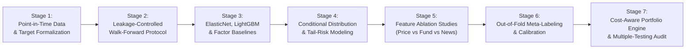

 AlphaNiti: Research Roadmap & Literature Anchoring Guide

## 1. The 10 Ranked Theoretical Upgrades

The quantitative literature supports these 10 upgrades as the strongest foundation for AlphaNiti. They make the research specification complete, defensible, and falsifiable:

1. **Predict a Conditional Return Distribution, Not Just a Point Estimate**  
   Estimate conditional quantiles or a return distribution $F _ H(r \mid X _ t)$, then derive expected returns and downside probabilities. Evaluates both reward and tail risk. *(Basis: Gu, Kelly & Xiu 2020)*
2. **Make Point-in-Time Data Integrity a Formal Invariant**  
   Enforce availability-time joins, historical constituent membership, filing-version history, and delisted-stock coverage. No feature may use information unavailable at the forecast origin.
3. **Use Nested Walk-Forward Validation Plus CPCV**  
   Walk-forward evaluation simulates deployment. CPCV and probability-of-backtest-overfitting (PBO) analysis supplement robustness. Purging must use actual label intervals. *(Basis: López de Prado 2018; Bailey et al. 2017)*
4. **Require Controlled Ablation Experiments**  
   Compare price-only, fundamentals-only, news-only, and combined models. Each feature family must demonstrate incremental value on untouched test periods. *(Basis: Ke, Kelly & Xiu 2019)*
5. **Benchmark Model Families Rather Than Excluding Deep Learning by Rule**  
   Keep ElasticNet and LightGBM as baselines, but test a shallow neural network under identical conditions. Reject additional complexity when it fails to improve robust out-of-sample performance. *(Basis: Gu, Kelly & Xiu 2020)*
6. **Make Meta-Labeling Conditional on Out-of-Fold Predictions**  
   Define the trade-success label in advance, train the meta-model only on eligible out-of-fold forecasts, and compare it with a single-stage baseline. Measure whether it improves net utility, downside recall, or drawdown. *(Basis: López de Prado 2018)*
7. **Formalize Probability Calibration**  
   Compare isotonic regression, sigmoid calibration, and uncalibrated probabilities using independent temporal calibration data. Report Brier score, log loss, and reliability diagrams for downside events.
8. **Model Cross-Sectional Dependence and Regime Instability**  
   Group stocks by date during validation, account for common market/sector shocks, and evaluate performance across distinct market regimes using date-clustered standard errors.
9. **Separate Forecasting from Portfolio Construction**  
   Define execution timing, transaction costs, liquidity limits, exposure constraints, and the portfolio objective independently from the return model.
10. **Control Research-Wide Multiple Testing**  
    Record every attempted model, feature set, horizon, threshold, and strategy configuration. Report uncertainty and selection-bias diagnostics (Deflated Sharpe Ratio, PBO). *(Basis: Bailey et al. 2017)*

---

## 2. Literature Anchoring Matrix

| Academic Reference | What It Supports | What It Does NOT Prove |
| :--- | :--- | :--- |
| **Gu, Kelly & Xiu (2020)** *Empirical Asset Pricing via Machine Learning* | Nonlinear interactions, tree models, neural networks, return prediction | That LightGBM + ElasticNet is optimal for Indian NSE equities |
| **Ke, Kelly & Xiu (2019)** *Predicting Returns With Text Data* | Supervised text signals for asset return prediction | That generic FinBERT sentiment automatically predicts 20d/60d returns |
| **Dogu Araci (2019)** *FinBERT: Financial Sentiment Analysis* | Financial-domain sentiment representations | Profitable trading signals from sentiment alone |
| **Marcos López de Prado (2018)** *Advances in Financial Machine Learning* | Purging, embargoing, meta-labeling, financial ML validation | That a particular CPCV configuration eliminates every bias |
| **Bailey et al. (2017)** *The Probability of Backtest Overfitting* | Diagnosing strategy-selection overfitting and false discovery | That any single validation method guarantees live generalization |

---

## 3. Strict 7-Stage Implementation Sequence

1. **Stage 1:** Point-in-time data engine, bitemporal schema, and mathematical target definitions (Day $t+1$ execution, net of NSE statutory friction).
2. **Stage 2:** Leakage-controlled nested walk-forward cross-validation with date-grouped folds and $H$-day embargoing.
3. **Stage 3:** ElasticNet, LightGBM, and naive momentum/factor baselines.
4. **Stage 4:** Conditional return distribution estimation ($F _ H(r \mid X _ t)$) and downside-risk quantiles.
5. **Stage 5:** Rigorous ablation experiments (Price-only vs. Fund-only vs. News-only vs. Combined).
6. **Stage 6:** Out-of-fold meta-labeling and isotonic probability calibration.
7. **Stage 7:** Cost-aware portfolio construction, circuit-band checks, and Deflated Sharpe Ratio / PBO diagnostics.

---

## 4. Guiding Engineering Axiom

> *"The strongest design is the simplest one whose assumptions are defensible, whose tests are leakage-resistant, and whose added complexity demonstrates incremental value."*
