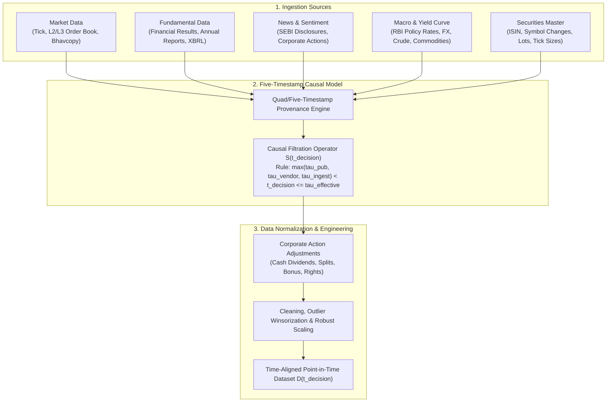

 Pipeline Module 1: Data Ingestion & Five-Timestamp Temporal Model
**Formal Specification, Mathematical Formulations, Corporate Action Adjustments & Literature**  
*AlphaNiti v25.0 Institutional Architecture — Part 1 & Part 2 (Revised per Architectural Callout 6)*

---

## 1. Module Overview & Architectural Placement

In production quantitative trading on the National Stock Exchange of India (NSE), information leakage and look-ahead bias constitute the primary causes of backtest-to-live performance collapse. This module establishes an uncompromising, mathematically verifiable **Five-Timestamp Causal Data Model** that governs all data ingestion, corporate action normalization, and point-in-time feature engineering prior to downstream predictive modeling.

---

## 2. The Five-Timestamp Causal Data Model (Callout 6)

### 2.1 Formal Timestamp Tuple Definition
Every ingested primitive observation $\mathbf{X}$ is stored as an immutable 6-tuple:

$$
\mathbf{X} \equiv \big( \text{EntityID}, \; \text{Field}, \; \text{Value}, \; \vec{\boldsymbol{\tau}}, \; \text{Hash} _ {\text{SHA256}} \big)
$$

where the temporal vector $\vec{\boldsymbol{\tau}} \in \mathbb{R} _ {\ge 0}^5$ comprises five distinct, strictly ordered physical and regulatory timestamps:

$$
\vec{\boldsymbol{\tau}} \equiv \begin{pmatrix} \tau^{\text{event}} \\ \tau^{\text{pub}} \\ \tau^{\text{vendor}} \\ \tau^{\text{ingest}} \\ \tau^{\text{effective}} \end{pmatrix}
$$

1. **Event Timestamp ($\tau^{\text{event}}$)**: The physical instant the real-world phenomenon occurred (e.g., matching engine execution timestamp for a trade, board meeting conclusion timestamp for quarterly financial results).
2. **Publication Timestamp ($\tau^{\text{pub}}$)**: The instant the information was officially broadcast to the public domain (e.g., regulatory disclosure upload on NSE NEAPS / BSE Listing Centre, press wire dispatch).
3. **Vendor Timestamp ($\tau^{\text{vendor}}$)**: The instant the data vendor (e.g., Bloomberg, Refinitiv, exchange data feed) packaged, stamped, and dispatched the transmission packet.
4. **Ingestion Timestamp ($\tau^{\text{ingest}}$)**: The local system wall-clock instant when the packet crossed the network interface card (NIC), was verified against cryptographic checksums, and was committed to non-volatile append-only storage.
5. **Effective Timestamp ($\tau^{\text{effective}}$)**: The regulatory or market instant when the information legally and operationally takes effect for trading (e.g., ex-date for corporate actions, market open $t _ {09:15:00}$ following an after-hours filing).

### 2.2 Temporal Monotonicity Axiom
For any valid data record $\mathbf{X}$:

$$
\tau^{\text{event}}(\mathbf{X}) \le \tau^{\text{pub}}(\mathbf{X}) \le \tau^{\text{vendor}}(\mathbf{X}) \le \tau^{\text{ingest}}(\mathbf{X})
$$

Any incoming payload violating this monotonicity ordering is quarantined immediately into an error ledger, raising an `IngestionMonotonicityViolation` alert.

### 2.3 Causal Eligibility Operator
Let $t _ {\text{decision}}$ denote the discrete time cutoff at which the portfolio optimization engine is triggered. The **Causal Filtration Operator** $\mathcal{F} _ {t _ {\text{decision}}}$ is formally defined as:

$$
\mathcal{F} _ {t _ {\text{decision}}} \equiv \left\lbrace \mathbf{X} \in \mathcal{D} \;\middle\vert\; \max\big( \tau^{\text{pub}}(\mathbf{X}), \; \tau^{\text{vendor}}(\mathbf{X}), \; \tau^{\text{ingest}}(\mathbf{X}) \big) < t _ {\text{decision}} \;\land\; \tau^{\text{effective}}(\mathbf{X}) \le t _ {\text{decision}} \right\rbrace
$$

#### Crucial Invariant Properties:
- **Strict Inequality ($<$)**: Enforces that information arriving in the exact millisecond of the decision cycle cannot be acted upon within the same millisecond, precluding zero-latency lookahead.
- **Effective Date Barrier ($\le$)**: Precludes trading on future-dated events (e.g., a stock split announced on Monday with ex-date on Thursday cannot alter historical share quantities until Thursday's pre-open session).

---

## 3. Corporate Action Adjustment Formulations

Unadjusted price and volume series exhibit synthetic price discontinuities when corporate actions occur. AlphaNiti maintains both **Unadjusted (Raw Point-in-Time)** series for exact execution accounting and **Causally Adjusted** series for statistical feature extraction.

### 3.1 Cumulative Adjustment Factor
Let $k \in \lbrace 1, \dots, K\rbrace$ index the historical corporate action events for asset $i$ occurring at ex-dates $t _ k$. The cumulative adjustment factor at historical time $t$ relative to decision date $t _ {\text{decision}}$ is:

$$
c _ i(t \mid t _ {\text{decision}}) \equiv \prod _ {k: \; t < t _ k \le t _ {\text{decision}}} f _ {i, k}
$$

where $f _ {i, k}$ is the event-specific adjustment factor.

### 3.2 Canonical Corporate Action Multipliers

#### 1. Stock Splits and Consolidations (Reverse Splits)
For a split of $A$ existing shares into $B$ new shares (e.g., 10:1 split, $A=1, B=10$):

$$
f _ {i, k} = \frac{A}{B}
$$

$$
\widetilde{P} _ i(t) = P _ i(t) \cdot f _ {i, k}, \qquad \widetilde{V} _ i(t) = V _ i(t) \cdot \frac{1}{f _ {i, k}}
$$

#### 2. Bonus Share Issues
For a bonus issue in the ratio of $B$ bonus shares for every $A$ existing shares held (e.g., 1:1 bonus, $A=1, B=1$):

$$
f _ {i, k} = \frac{A}{A + B}
$$

#### 3. Rights Offerings
For a rights offering of $B$ shares at subscription price $P _ {\text{rights}}$ for every $A$ shares held, where $P _ {\text{cum}}$ is the closing price on the last cum-rights day:

$$
P _ {\text{ex-theoretical}} = \frac{A \cdot P _ {\text{cum}} + B \cdot P _ {\text{rights}}}{A + B}
$$

$$
f _ {i, k} = \frac{P _ {\text{ex-theoretical}}}{P _ {\text{cum}}} = \frac{A \cdot P _ {\text{cum}} + B \cdot P _ {\text{rights}}}{(A + B) \cdot P _ {\text{cum}}}
$$

#### 4. Ordinary Cash Dividends
For a cash dividend of $D$ per share with cum-dividend closing price $P _ {\text{cum}}$:

$$
f _ {i, k} = 1 - \frac{D}{P _ {\text{cum}}}
$$

*Note: For cash dividend adjustments, prices are scaled by $f _ {i, k}$ while volume remains invariant.*

---

## 4. Data Processing, Cleaning & Normalization

### 4.1 Robust Scale & Outlier Winsorization
Raw return distributions in Indian equities exhibit heavy tails and intermittent microstructure outliers. Raw features are normalized using the **Median Absolute Deviation (MAD)** rather than sample standard deviation:

$$
\text{Median} _ i = \text{median}(\mathbf{x} _ i)
$$

$$
\text{MAD} _ i = 1.4826 \cdot \text{median}\big( |\mathbf{x} _ i - \text{Median} _ i| \big)
$$

The modified robust Z-score is defined as:

$$
z _ {i, t} = \frac{x _ {i, t} - \text{Median} _ i}{\max\big( \text{MAD} _ i, \; 10^{-6} \big)}
$$

Features are softly winsorized at threshold $c _ {\text{clip}} = 4.5$:

$$
\widetilde{z} _ {i, t} = \text{sign}(z _ {i, t}) \cdot \min\big( |z _ {i, t}|, \; c _ {\text{clip}} \big)
$$

---

## 5. Academic Literature & References

1. **Asness, C., Frazzini, A., Israel, R., & Moskowitz, T. (2014)**. *Fact, Fiction, and Value Investing*. The Journal of Portfolio Management, 40(1), 74-92. [DOI: 10.3905/jpm.2014.40.1.074]  
   *Establishes the empirical necessity of strict point-in-time financial statement alignment to eliminate restatement and disclosure lag bias.*

2. **López de Prado, M. (2018)**. *Advances in Financial Machine Learning*. John Wiley & Sons. ISBN: 978-1-119-48208-6.  
   *Chapter 2: Financial Data Structures & Information-Driven Bars; Chapter 3: The Dangers of Lookahead in Backtesting.*

3. **Brown, S. J., Goetzmann, W., Ibbotson, R. G., & Ross, S. A. (1992)**. *Survivorship Bias in Performance Studies*. The Review of Financial Studies, 5(4), 553-580. [DOI: 10.1093/rfs/5.4.553]  
   *Proves that failure to maintain a dynamic historical securities master with delisted, merged, and suspended tickers artificially inflates Sharpe ratios.*

4. **Biais, B., Hillion, P., & Spatt, C. (1995)**. *An Empirical Analysis of the Limit Order Book and the Order Flow in the Paris Bourse*. The Journal of Finance, 50(5), 1655-1689. [DOI: 10.1111/j.1540-6261.1995.tb05192.x]  
   *Formulates order book event-time versus clock-time filtration models for microstructure feeds.*

5. **Engle, R. F., & Russell, J. R. (1998)**. *Autoregressive Conditional Duration: A New Model for Irregularly Spaced Transaction Data*. Econometrica, 66(5), 1127-1162. [DOI: 10.2307/2999632]  
   *Foundational mathematical framework for asynchronous temporal point processes in high-frequency trading.*
