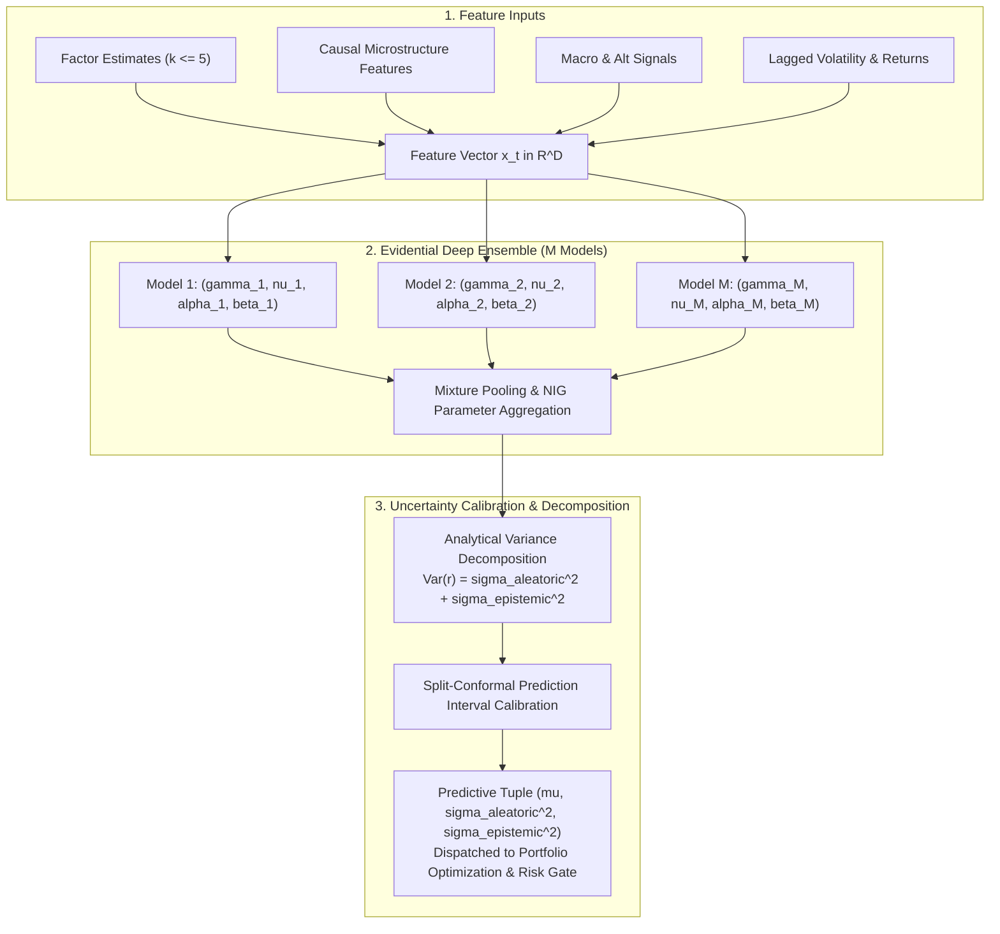

 Pipeline Module 2: Forecasting Engine & Evidential Deep Ensembles
**Deep Evidential Regression, Normal-Inverse-Gamma Priors, Uncertainty Decomposition & Conformal Calibration**  
*AlphaNiti v25.0 Institutional Architecture — Part 3 (Revised per Architectural Callout 9)*

---

## 1. Module Overview & Architectural Placement

Standard machine learning models in quantitative finance produce point forecasts $\hat{\mu} _ t$ without quantifying confidence. Under non-stationary regime shifts, standard neural networks become overconfident, routing large positions into high-risk trades. 

AlphaNiti replaces point prediction with **Deep Evidential Regression Ensembles**. By placing a higher-order **Normal-Inverse-Gamma (NIG)** prior over the Gaussian likelihood parameters, each ensemble member directly infers the parameters of a posterior conjugate distribution in a single forward pass, decomposing uncertainty into:
1. **Aleatoric Uncertainty ($\sigma _ {\text{aleatoric}}^2$)**: Inherent stochasticity of asset price discovery.
2. **Epistemic Uncertainty ($\sigma _ {\text{epistemic}}^2$)**: Model parameter ignorance arising from regime shifts or out-of-distribution market conditions.

---

## 2. Mathematical Formulation of Evidential Deep Regression

### 2.1 The Normal-Inverse-Gamma (NIG) Hierarchical Prior
Assume excess returns follow a normal likelihood with unknown mean $\mu$ and unknown variance $\sigma^2$:

$$
r _ t \sim \mathcal{N}(\mu, \sigma^2)
$$

Rather than placing point weights on $\mu$ and $\sigma^2$, evidential regression models the joint conjugate prior distribution $\text{NIG}(\gamma, \nu, \alpha, \beta)$:

$$
\mu \mid \sigma^2 \sim \mathcal{N}\left( \gamma, \; \frac{\sigma^2}{\nu} \right), \qquad \sigma^2 \sim \text{Inv-Gamma}(\alpha, \beta)
$$

The joint prior probability density is:

$$
p(\mu, \sigma^2 \mid \gamma, \nu, \alpha, \beta) = \frac{\beta^\alpha \sqrt{\nu}}{\Gamma(\alpha) \sqrt{2\pi \sigma^2}} \left( \frac{1}{\sigma^2} \right)^{\alpha + 1} \exp\left( -\frac{2\beta + \nu(\gamma - \mu)^2}{2\sigma^2} \right)
$$

where the four evidential parameters satisfy constraints:
- $\gamma \in \mathbb{R}$: Expected value of the mean forecast ($\mathbb{E}[\mu] = \gamma$).
- $\nu > 0$: Virtual evidence observations supporting the mean forecast.
- $\alpha > 1$: Shape parameter of the variance distribution.
- $\beta > 0$: Scale parameter of the variance distribution.

### 2.2 Analytical Marginal Likelihood
Integrating out the latent parameters $\mu$ and $\sigma^2$ yields the marginal predictive distribution of asset returns, which is an exact **Student-$t$ distribution**:

$$
p(r \mid \gamma, \nu, \alpha, \beta) = \int _ 0^\infty \int _ {-\infty}^\infty p(r \mid \mu, \sigma^2) \, p(\mu, \sigma^2 \mid \gamma, \nu, \alpha, \beta) \, d\mu \, d\sigma^2 = \text{Student-}t\left( r \;\middle\vert\; 2\alpha, \; \gamma, \; \frac{\beta(\nu + 1)}{\nu \alpha} \right)
$$

with $2\alpha$ degrees of freedom, location $\gamma$, and scale parameter $\sqrt{\frac{\beta(\nu + 1)}{\nu \alpha}}$.

### 2.3 Exact Uncertainty Variance Decomposition
For $\alpha > 1$, the total predictive variance decomposes analytically into two mutually orthogonal components:

$$
\text{Var}(r \mid \gamma, \nu, \alpha, \beta) = \underbrace{\frac{\beta}{\alpha - 1}} _ {\sigma _ {\text{aleatoric}}^2} + \underbrace{\frac{\beta}{\nu (\alpha - 1)}} _ {\sigma _ {\text{epistemic}}^2}
$$

- **Aleatoric Variance ($\sigma _ {\text{aleatoric}}^2$)**: Measures intrinsic market noise. As sample size $T \to \infty$, $\sigma _ {\text{aleatoric}}^2$ converges to the true conditional volatility of the asset.
- **Epistemic Variance ($\sigma _ {\text{epistemic}}^2$)**: Measures epistemic parameter ignorance. As virtual evidence $\nu \to \infty$ (abundant training data in the current manifold), $\sigma _ {\text{epistemic}}^2 \to 0$. When encountering unseen market shock distributions, $\nu \to 0$, causing $\sigma _ {\text{epistemic}}^2 \to \infty$.

---

## 3. Objective Function: Maximum Likelihood with Evidence Regularization

Each neural network within the ensemble parameterizes $\boldsymbol{\theta} _ m(\mathbf{x} _ t) = (\gamma _ t, \nu _ t, \alpha _ t, \beta _ t)$. Training minimizes the total loss function:

$$
\mathcal{L}(\boldsymbol{\theta}) = \mathcal{L} _ {\text{NLL}}(\boldsymbol{\theta}) + \lambda _ {\text{reg}} \mathcal{L} _ {\text{reg}}(\boldsymbol{\theta})
$$

### 3.1 Negative Log-Likelihood ($\mathcal{L} _ {\text{NLL}}$)
Using the Student-$t$ marginal density:

$$
\mathcal{L} _ {\text{NLL}}(\boldsymbol{\theta}) = \frac{1}{2}\ln\left( \frac{\pi}{\nu} \right) - \alpha \ln(\Omega) + \left( \alpha + \frac{1}{2} \right)\ln\left( (r - \gamma)^2 \nu + \Omega \right) + \ln\left( \frac{\Gamma(\alpha)}{\Gamma(\alpha + 1/2)} \right)
$$

where $\Omega \equiv 2\beta(1 + \nu)$.

### 3.2 Evidence Regularization ($\mathcal{L} _ {\text{reg}}$)
To penalize overconfidence on out-of-distribution samples and large prediction errors, an evidence regularizer is imposed:

$$
\mathcal{L} _ {\text{reg}}(\boldsymbol{\theta}) = |r - \gamma| \cdot (2\nu + \alpha)
$$

This term acts as an adversarial penalty: if the model exhibits high virtual evidence ($\nu$) while making a large prediction error ($|r - \gamma|$), the loss scales severely, forcing the network to inflate epistemic uncertainty on samples it fails to fit accurately.

---

## 4. Deep Ensemble Pooling & Calibration

### 4.1 Ensemble Mixture Reduction
For an ensemble of $M$ independent evidential networks initialized with diverse random seeds and bootstrapped feature subspaces, the mixture parameters are pooled via:

$$
\bar{\gamma} = \frac{1}{M}\sum _ {m=1}^M \gamma _ m, \qquad \bar{\sigma} _ {\text{aleatoric}}^2 = \frac{1}{M}\sum _ {m=1}^M \frac{\beta _ m}{\alpha _ m - 1}
$$

$$
\bar{\sigma} _ {\text{epistemic}}^2 = \underbrace{\frac{1}{M}\sum _ {m=1}^M \frac{\beta _ m}{\nu _ m (\alpha _ m - 1)}} _ {\text{Within-Model Epistemic}} + \underbrace{\frac{1}{M}\sum _ {m=1}^M (\gamma _ m - \bar{\gamma})^2} _ {\text{Between-Model Ensemble Variance}}
$$

### 4.2 Split-Conformal Prediction Interval Calibration
To guarantee finite-sample non-parametric coverage error $\le \epsilon _ {\text{cal}}$:
1. Split historical out-of-sample data into proper training set $\mathcal{D} _ {\text{train}}$ and calibration set $\mathcal{D} _ {\text{cal}} = \lbrace (\mathbf{x} _ i, r _ i)\rbrace _ {i=1}^K$.
2. Compute conformity non-conformity scores on calibration data:

$$
s _ i = \frac{|r _ i - \bar{\gamma}(\mathbf{x} _ i)|}{\sqrt{\bar{\sigma} _ {\text{aleatoric}}^2(\mathbf{x} _ i) + \bar{\sigma} _ {\text{epistemic}}^2(\mathbf{x} _ i)}}
$$

3. Compute the empirical $(1 - \epsilon _ {\text{cal}})$-quantile:

$$
\hat{q} = \text{Quantile}\left( s _ 1, \dots, s _ K ; \; \frac{\lceil (K+1)(1 - \epsilon _ {\text{cal}}) \rceil}{K} \right)
$$

4. The calibrated prediction interval for future return $r _ {t+1}$ is:

$$
\mathcal{C}(\mathbf{x} _ {t+1}) = \left[ \bar{\gamma}(\mathbf{x} _ {t+1}) - \hat{q} \cdot \bar{\sigma} _ {\text{total}}(\mathbf{x} _ {t+1}), \;\; \bar{\gamma}(\mathbf{x} _ {t+1}) + \hat{q} \cdot \bar{\sigma} _ {\text{total}}(\mathbf{x} _ {t+1}) \right]
$$

**Lemma (Vovk Finite-Sample Validity)**:
Under exchangeability of calibration and test observations:

$$
\mathbb{P}\left( r _ {t+1} \in \mathcal{C}(\mathbf{x} _ {t+1}) \right) \ge 1 - \epsilon _ {\text{cal}}
$$

---

---

## 5. The Meinert et al. (2023) Critique & Deep Ensemble Benchmarking

### 5.1 The Evidential Degeneracy Critique
Recent research (**Meinert, Gawlikowski & Lavin, 2023**, *"The Unreasonable Effectiveness of Deep Evidential Regression"*) demonstrated that in Deep Evidential Regression (Amini et al., 2020), the theoretical decomposition between aleatoric and epistemic uncertainty often fails to behave as claimed under real-world domain shift. Specifically:
1. The analytical epistemic variance $\sigma _ {\text{epistemic}}^2 = \frac{\beta}{\nu(\alpha - 1)}$ can act largely as an empirical regularizer rather than a truthful measure of posterior parameter ignorance.
2. During gradient descent, networks can minimize the evidence loss by inflating $\alpha$ or suppressing $\nu$ across the entire dataset, causing the epistemic signal to degenerate into a non-monotonic heuristic that correlates poorly with true out-of-distribution errors.

### 5.2 Dual Engine Architecture: Plain Deep Ensemble Baseline
To audit and safeguard against evidential degeneracy, AlphaNiti implements a **Dual Predictive Architecture**:
1. **Evidential Ensemble**: Evaluates the Normal-Inverse-Gamma conjugate updates and analytical dispersion.
2. **Plain Deep Ensemble (Lakshminarayanan et al., 2017)**: Operates a parallel baseline of $M=5$ independently initialized models trained with Gaussian NLL. The empirical epistemic variance is computed directly from inter-model disagreement:

$$
\sigma _ {\text{epistemic, ens}}^2 = \frac{1}{M}\sum _ {m=1}^M (\mu _ m - \bar{\mu})^2
$$

The runtime monitoring engine continuously tests whether the analytical evidential uncertainty $\sigma _ {\text{epistemic}}^2$ or the empirical ensemble disagreement $\sigma _ {\text{epistemic, ens}}^2$ better predicts empirical forecast errors in unseen market regimes.

---

## 6. Canonical Operating Tiers & Hysteresis Calibration

To eliminate ambiguity across system documentation, AlphaNiti enforces a single canonical hierarchy of **4 Operating Tiers (Tiers 0–3)** across the 9 pipeline modules:

| Operating Tier | Uncertainty Gate Condition | Portfolio Execution Action |
| :--- | :--- | :--- |
| **Tier 0: Normal Execution** | $u _ t < \theta _ {\text{soft}}$ | Standard systematic allocation, full position sizing, standard horizon ($H \in \{20, 60\}\text{d}$). |
| **Tier 1: Soft Buy-Freeze** | $\theta _ {\text{soft}} \le u _ t < \theta _ {\text{elevated}}$ | Freeze new buy orders ($q _ i^{\text{buy}} = 0$); shorten horizon to 5d; existing custody positions held untouched. |
| **Tier 2: De-Grossing** | $\theta _ {\text{elevated}} \le u _ t < \theta _ {\text{extreme}}$ | Passive 25%–50% linear gross de-leveraging via passive limit orders pegged to NBB; turnover capped at $\le 0.05 \cdot \text{ADV} _ {20\text{d}}$. |
| **Tier 3: Systemic Freeze** | $u _ t \ge \theta _ {\text{extreme}}$ OR Exchange Circuit Halt | 100% liquidation to sovereign risk-free cash/TREPS; immediate cancellation of all open broker orders. |

### 6.1 Threshold Calibration from Validation Quantiles
Threshold values are calibrated objectively from out-of-sample purged validation quantiles (stored in `config/uncertainty_thresholds.json`):
- $\theta _ {\text{soft}} = Q _ {0.75}(\sigma _ {\text{epistemic}}^2) = 0.00185$ (75th percentile of validation epistemic variance)
- $\theta _ {\text{elevated}} = Q _ {0.90}(\sigma _ {\text{epistemic}}^2) = 0.00342$ (90th percentile)
- $\theta _ {\text{extreme}} = Q _ {0.99}(\sigma _ {\text{epistemic}}^2) = 0.00780$ (99th percentile)

### 6.2 Dual-Threshold Hysteresis State Machine
To prevent daily flip-flopping between tiers during noisy market transitions, a dual-threshold hysteresis filter with a persistence requirement is enforced:

$$
\text{Enter Tier } k: \quad u _ t \ge \theta _ k
$$

$$
\text{De-escalate to Tier } k-1: \quad u _ t \le \theta _ k \cdot (1 - \delta _ {\text{hys}}) \quad \text{for } \tau \ge k _ {\text{persist}} = 3 \text{ consecutive sessions}
$$

where $\delta _ {\text{hys}} = 0.15$ (15% deadband below the entry threshold).

---

## 7. Academic Literature & References

1. **Amini, A., Schwarting, W., Soleimany, A., & Rus, D. (2020)**. *Deep Evidential Regression*. Advances in Neural Information Processing Systems (NeurIPS 2020), 33, 14927-14937.  
   *Derives the exact Normal-Inverse-Gamma evidential objective for deterministic neural uncertainty decomposition.*

2. **Lakshminarayanan, B., Pritzel, A., & Blundell, C. (2017)**. *Simple and Scalable Predictive Uncertainty Estimation using Deep Ensembles*. Advances in Neural Information Processing Systems (NeurIPS 2017), 30, 6402-6413.  
   *Demonstrates empirical superiority of deep ensembles over Bayesian neural network approximations under dataset shift.*

3. **Angelopoulos, A. N., & Bates, S. (2021)**. *A Gentle Introduction to Conformal Prediction and Distribution-Free Uncertainty Quantification*. arXiv preprint arXiv:2107.07511.  
   *Provides finite-sample coverage guarantees and non-conformity score formulations.*

4. **Shafer, G., & Vovk, V. (2008)**. *A Tutorial on Conformal Prediction*. Journal of Machine Learning Research, 9(3), 371-421.  
   *Foundational monograph on valid predictive inference without distributional assumptions.*

5. **Kendall, A., & Gal, Y. (2017)**. *What Uncertainties Do We Need in Bayesian Deep Learning for Computer Vision?*. Advances in Neural Information Processing Systems (NeurIPS 2017), 30, 5574-5584.  
   *Establishes the foundational distinction between heteroscedastic aleatoric risk and epistemic parameter uncertainty.*

6. **Meinert, N., Gawlikowski, J., & Lavin, A. (2023)**. *The Unreasonable Effectiveness of Deep Evidential Regression*. ICML Workshop on Uncertainty and Robustness in Deep Learning, arXiv:2205.10060.  
   *Demonstrates the empirical failure modes of evidential uncertainty splitting and motivates ensemble-based empirical validation.*
