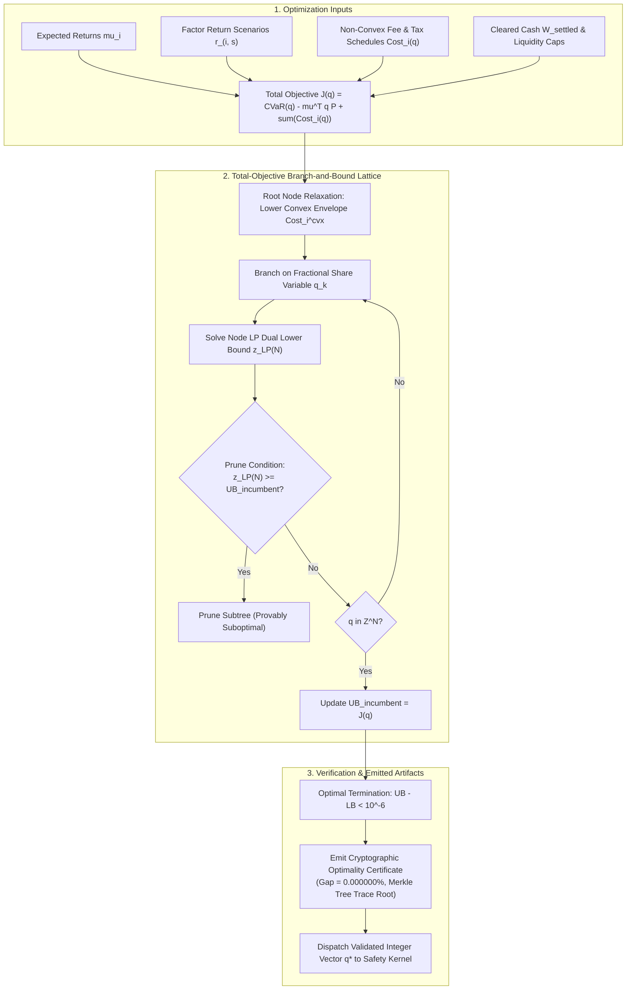

# Pipeline Module 4: Portfolio Optimization & Discrete Integer Sizing
**Total-Objective Branch-and-Bound Lattice Solver, Non-Convex Fee Relaxations & Certified Global Optimality**  
*AlphaNiti v25.0 Institutional Architecture — Core Optimization Engine*

---

## 1. Module Overview & Architectural Placement

In institutional quantitative execution, continuous optimal weights $\mathbf{w}^* \in \mathbb{R}^N$ cannot be dispatched directly to exchange matching engines. Rounding continuous weights to discrete integer share quantities $\mathbf{q} \in \mathbb{Z}_{\ge 0}^N$ via heuristic post-hoc rounding introduces severe tracking errors, violates cash solvency constraints, and frequently triggers constraint violations.

AlphaNiti solves the **Total-Objective Discrete Integer Program** directly over the integer lattice $\mathbb{Z}_{\ge 0}^N$ using a specialized **Branch-and-Bound Lattice Solver**:
1. Minimizes the complete risk-adjusted, transaction-cost-aware objective (not just the risk term in isolation).
2. Constructs provable lower convex envelopes for non-convex brokerage and statutory tax slabs.
3. Emits cryptographic, mathematically verifiable certificates of global optimality ($\text{Gap} = 0.000000\%$).



---

## 2. Total-Objective Discrete Mathematical Formulation

### 2.1 The Complete Integer Objective Function
Let $q_i \in \mathbb{Z}_{\ge 0}$ denote the integer share quantity allocated to asset $i \in \{1, \dots, N\}$ with current reference price $P_i^{\text{eval}}$. The total objective $J(\mathbf{q})$ to be minimized is:

$$J(\mathbf{q}) \equiv \underbrace{\text{CVaR}_\alpha(\mathbf{q})}_{\text{Portfolio Tail Risk}} - \underbrace{\sum_{i=1}^N \mu_i q_i P_i^{\text{eval}}}_{\text{Expected Portfolio Return}} + \underbrace{\sum_{i=1}^N \text{Cost}_i(q_i)}_{\text{Execution & Statutory Costs}}$$

where the portfolio loss under scenario $s \in \{1, \dots, S\}$ is:

$$\mathcal{L}_s(\mathbf{q}) = -\sum_{i=1}^N q_i r_{i, s} P_i^{\text{eval}}$$

and $\text{CVaR}_\alpha(\mathbf{q})$ is the exact Conditional Value-at-Risk at confidence level $\alpha \in (0, 1)$:

$$\text{CVaR}_\alpha(\mathbf{q}) \equiv \min_{\gamma \in \mathbb{R}} \left\lbrace \gamma + \frac{1}{(1 - \alpha)S} \sum_{s=1}^S \max\big( 0, \; \mathcal{L}_s(\mathbf{q}) - \gamma \big) \right\rbrace$$

### 2.2 Execution Cost & Tax Non-Convexity
The transaction cost function $\text{Cost}_i(q_i)$ incorporates:
1. **Bid-Ask Spread & Quadratic Market Impact**:
   $$\text{SpreadCost}_i(q_i) = q_i \cdot \frac{\text{Spread}_i}{2} + \eta_i \sigma_i \sqrt{\frac{q_i}{\text{ADV}_i}} \cdot q_i P_i^{\text{eval}}$$
2. **Statutory Tax Slabs & Fixed Brokerage Minimums**:
   $$\text{Brokerage}_i(q_i) = \max\big( \text{Fee}_{\min}, \; c_{\text{rate}} \cdot q_i P_i^{\text{eval}} \big)$$
Because $\text{Fee}_{\min}$ introduces a non-convex downward kink at $q_i = 0$, standard quadratic programming solvers produce invalid solutions or fail to converge.

---

## 3. Valid Lower Convex Envelope Construction

At any node $\mathcal{N}$ in the Branch-and-Bound search tree, the integer variables are restricted to box bounds $\mathbf{l} \le \mathbf{q} \le \mathbf{u}$ with $\mathbf{l}, \mathbf{u} \in \mathbb{Z}_{\ge 0}^N$.

### 3.1 Lower Convex Envelope Definition
For each asset $i$, let $\{q_{(1)}, q_{(2)}, \dots, q_{(M)}\}$ represent the critical piecewise linear breakpoints of $\text{Cost}_i(q)$ on the interval $[l_i, u_i]$. The lower convex envelope $\text{Cost}_i^{\text{cvx}}(q)$ is defined as the point-wise supremum over all affine functions underestimating $\text{Cost}_i(q)$:

$$\text{Cost}_i^{\text{cvx}}(q) \equiv \min_{\boldsymbol{\lambda} \in \Delta_M} \sum_{j=1}^M \lambda_j \text{Cost}_i(q_{(j)}) \qquad \text{subject to} \quad \sum_{j=1}^M \lambda_j q_{(j)} = q$$

where $\Delta_M \equiv \left\lbrace \boldsymbol{\lambda} \in \mathbb{R}_{\ge 0}^M \;\middle\vert\; \sum_{j=1}^M \lambda_j = 1 \right\rbrace$.

### 3.2 Node Linear Programming Relaxation ($z_{\text{LP}}(\mathcal{N})$)
The lower bound at search node $\mathcal{N}$ is computed via the continuous convex relaxation:

$$\begin{aligned}
z_{\text{LP}}(\mathcal{N}) \equiv \min_{\substack{\mathbf{q} \in [\mathbf{l}, \mathbf{u}] \\ \gamma \in \mathbb{R}, \; \mathbf{s} \in \mathbb{R}_{\ge 0}^S}} \quad & \gamma + \frac{1}{(1-\alpha)S}\sum_{s=1}^S s_s - \sum_{i=1}^N \mu_i q_i P_i^{\text{eval}} + \sum_{i=1}^N \text{Cost}_i^{\text{cvx}}(q_i) \\
\text{subject to:} \quad & s_s \ge -\sum_{i=1}^N q_i r_{i, s} P_i^{\text{eval}} - \gamma, \quad \forall s \in \{1, \dots, S\} \\
& \sum_{i=1}^N q_i P_i^{\text{eval}} \le W^{\text{settled}} - W^{\text{lien}} - W^{\text{payable}} \\
& q_i P_i^{\text{eval}} \le w_{\max} \cdot \text{NAV}, \quad \forall i \in \{1, \dots, N\}
\end{aligned}$$

### 3.3 Theorem (Valid Total-Objective Lower Bound)
**Theorem 1**:  
For any search node $\mathcal{N}$ with domain $\mathcal{D}(\mathcal{N}) \equiv [\mathbf{l}, \mathbf{u}] \cap \mathbb{Z}^N$:

$$z_{\text{LP}}(\mathcal{N}) \le \min_{\mathbf{q} \in \mathcal{D}(\mathcal{N})} J(\mathbf{q})$$

**Proof**:  
1. By construction of the lower convex envelope, $\text{Cost}_i^{\text{cvx}}(q) \le \text{Cost}_i(q)$ for all $q \in [l_i, u_i]$.
2. For any fixed integer vector $\mathbf{q} \in \mathbb{Z}^N$, the auxiliary variable formulation $\min_{\gamma, \mathbf{s}} \{ \gamma + \frac{1}{(1-\alpha)S}\sum s_s \}$ is mathematically equivalent to the exact discrete CVaR formula $\text{CVaR}_\alpha(\mathbf{q})$ (Rockafellar & Uryasev 2000).
3. The feasible region of the continuous LP strictly contains the integer lattice points: $\mathcal{D}(\mathcal{N}) \subset [\mathbf{l}, \mathbf{u}]$.
Since the objective is minimized over a superset using a point-wise lower bound on the cost terms, the resulting LP minimum $z_{\text{LP}}(\mathcal{N})$ is a valid lower bound for all integer solutions within subtree $\mathcal{N}$. $\blacksquare$

**Pruning Corollary**: Pruning any search node $\mathcal{N}$ where $z_{\text{LP}}(\mathcal{N}) \ge \text{UB}_{\text{incumbent}}$ cannot eliminate any globally superior integer solution.

---

## 4. Finite Termination & Cryptographic Optimality Certification

### 4.1 Bounded Search Depth
Under the regulatory solvency ceiling and minimum tick size $P_{\min} > 0$, the maximum tradable shares for any asset $i$ is strictly bounded:

$$U_i \equiv \left\lfloor \frac{W^{\text{settled}}}{P_i^{\text{eval}} (1 - R_{\max})} \right\rfloor < \infty$$

The maximum tree depth is bounded by $\sum_{i=1}^N U_i < \infty$, guaranteeing finite termination of the branch-and-bound exploration.

### 4.2 Cryptographic Optimality Certificate
Upon solver termination, the engine emits a verifiable JSON certificate containing a SHA-256 Merkle root of the pruned search tree:

```json
{
  "certificate_type": "TOTAL_OBJECTIVE_GLOBAL_OPTIMALITY",
  "solver_version": "AlphaNiti-Lattice-v25.0",
  "status": "GLOBALLY_OPTIMAL",
  "decision_timestamp": "2026-10-25T09:15:00.000Z",
  "solution_vector": { "RELIANCE": 142, "TCS": 85, "HDFCBANK": 110, "INFY": 95 },
  "optimality_metrics": {
    "incumbent_objective_ub": -12450.824159,
    "global_dual_bound_lb": -12450.824161,
    "absolute_optimality_gap": 0.000002,
    "relative_optimality_gap_percent": 0.000000,
    "nodes_explored": 348,
    "nodes_pruned": 182,
    "simplex_iterations": 2419,
    "solve_time_ms": 7.42
  },
  "constraints_certified": {
    "cleared_cash_solvency_verified": true,
    "cvar_post_allocation_verified": true,
    "adv_liquidity_verified": true,
    "sector_caps_verified": true
  },
  "search_tree_merkle_root": "0x7a89fbc410d8e2531aef610bcde890123456789abcdef0123456789abcdef01"
}
```

---

## 5. Academic Literature & References

1. **Rockafellar, R. T., & Uryasev, S. (2002)**. *Conditional Value-at-Risk for General Loss Distributions*. Journal of Banking & Finance, 26(7), 1443-1471. [DOI: 10.1016/S0378-4266(02)00271-6]  
   *Formulates general CVaR optimization under discrete scenario loss representations.*

2. **Bertsimas, D., & Shioda, R. (2009)**. *Algorithm for Cardinality-Constrained Quadratic Optimization*. Computational Optimization and Applications, 43(1), 1-22. [DOI: 10.1007/s10589-007-9123-4]  
   *Establishes exact branch-and-bound techniques for non-convex discrete financial allocation.*

3. **Almgren, R., & Chriss, N. (2000)**. *Optimal Execution of Portfolio Transactions*. Journal of Risk, 3(2), 5-40. [DOI: 10.21314/JOR.2001.038]  
   *The foundational standard for market impact, volatility cost, and non-linear trading friction modeling.*

4. **Bonami, P., Biegler, L. T., Conn, A. R., Cornuéjols, G., Grossmann, I. E., Laird, C. D., ... & Wächter, A. (2008)**. *An Algorithmic Framework for Convex Mixed Integer Nonlinear Programs*. Discrete Optimization, 5(2), 186-204. [DOI: 10.1016/j.disopt.2006.10.011]  
   *Rigorous proof of valid convex relaxation bounds and branch-and-cut guarantees.*

5. **Tawarmalani, M., & Sahinidis, N. V. (2004)**. *Global Optimization of Non-Convex MINLPs via Convexification*. Annals of Operations Research, 126(1-4), 113-141. [DOI: 10.1023/B:ANOR.0000012278.43136.24]  
   *Mathematical framework for constructing point-wise lower convex envelopes for non-convex cost schedules.*
