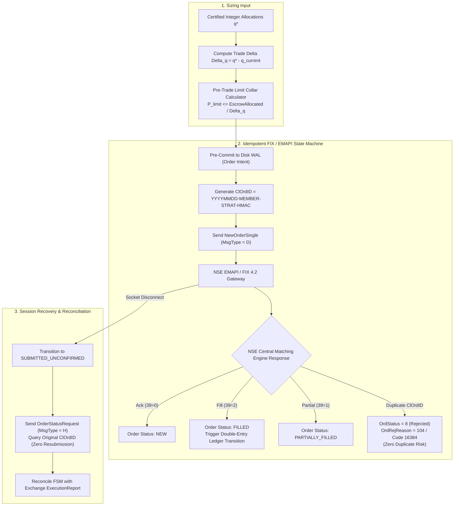
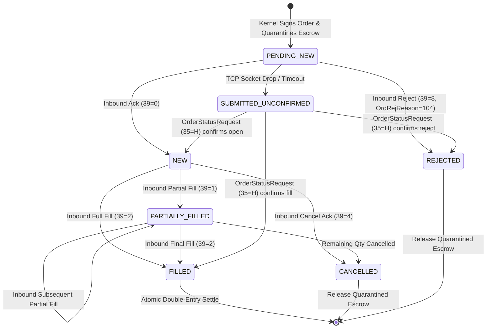

 Pipeline Module 5: Execution Engine & Official Exchange Protocol Integration
**NSE EMAPI Specification, FIX 4.2 Protocol Architecture, Idempotent Duplicate Order Prevention & Two-Phase Recovery**  
*AlphaNiti v25.0 Institutional Architecture — Part 5 (Revised per Architectural Callout 4)*

---

## 1. Module Overview & Architectural Placement

Algorithmic execution in the Indian capital markets requires direct compliance with the **National Stock Exchange of India (NSE) Enhanced Market Access Protocol Interface (EMAPI)** and the **Financial Information eXchange (FIX 4.2)** standard. 

In production, naive order dispatchers face critical hazards:
- Socket drops leading to duplicate orders upon reconnect.
- Ambiguous order states ("in-flight" orders executing while the local engine assumes failure).
- Sequence number gaps triggering session logouts during volatile market regimes.

AlphaNiti addresses these issues through an **Idempotent Exchange Protocol State Machine** (Callout 4) coupled to a **Write-Ahead Logging (WAL) Two-Phase Commit Engine**.



---

## 2. Official NSE EMAPI & FIX 4.2 Compliance (Callout 4 Resolution)

### 2.1 Uniqueness Scope & ClOrdID Specification
Under Section 4.3 of the *NSE India Cash Market FIX Protocol Specification*, client order identifier uniqueness is enforced per:

$$
\text{Scope} \equiv \big( \text{TradingMemberID}, \; \text{TraderID}, \; \text{OrderDate}, \; \text{ClOrdID} \big)
$$

AlphaNiti constructs an immutable 32-character canonical `ClOrdID` (Tag 11):

$$
\text{ClOrdID} \equiv \text{YYYYMMDD-MEMBER-STRAT-} \parallel \text{HMAC-SHA256}(K_{\text{secret}}, \; \text{Nonce} \parallel \text{Symbol} \parallel \text{Qty})_{[:14]}
$$

- **`YYYYMMDD`**: Trading date prefix matching the exchange business date.
- **`MEMBER`**: 5-digit SEBI registered Trading Member ID.
- **`STRAT`**: 4-character deterministic strategy identifier.
- **`HMAC-SHA256`**: Cryptographic hash preventing internal identifier collisions or spoofing.

### 2.2 Duplicate Order Rejection Semantics
If network latency or a gateway failover causes a retransmission of an identical `ClOrdID` within the same trading day:
1. The NSE Matching Engine rejects the transmission before passing it to the order book.
2. The exchange dispatches an `ExecutionReport (MsgType = 8)` with:
   - **`OrdStatus (Tag 39) = 8`** (`REJECTED`)
   - **`OrdRejReason (Tag 103) = 104`** (`Duplicate ClOrdID`)
   - **`Text (Tag 58)`** = `"16384: Order with duplicate ClOrdID already exists"`
3. The engine logs the duplicate rejection as an acknowledged idempotency event and does **not** treat it as an unhandled exception.

---

## 3. Order Lifecycle State Machine & Two-Phase Commit

### 3.1 Order State Transition Table
The formal execution state machine $\mathcal{S} _ {\text{exec}}$ enforces the following valid transitions:

| Current State | Event / Inbound Message | Next State | Action / Ledger Notification |
| :--- | :--- | :--- | :--- |
| **`IDLE`** | Dispatch request from Safety Kernel | **`PENDING_NEW`** | Append order intent to disk WAL; quarantine cash in Escrow |
| **`PENDING_NEW`**| Inbound `ExecutionReport (39=0)` (ACK) | **`NEW`** | Record `OrderID` (Tag 37); start fill timeout monitor |
| **`NEW`** | Inbound `ExecutionReport (39=1)` (Partial) | **`PARTIALLY_FILLED`** | Debit Escrow for partial shares; credit custody shares |
| **`PARTIALLY_FILLED`** | Inbound `ExecutionReport (39=2)` (Full Fill)| **`FILLED`** | Settle remaining Escrow; refund excess; order terminal |
| **`NEW`** / `PARTIAL` | Inbound `ExecutionReport (39=4)` (Cancelled) | **`CANCELLED`** | Release remaining Escrow back to Cleared Cash |
| **`PENDING_NEW`**| Inbound `ExecutionReport (39=8)` (Rejected) | **`REJECTED`** | Release 100% of Escrow back to Cleared Cash |
| **`PENDING_NEW`**| TCP Socket Disconnect / Heartbeat Timeout | **`SUBMITTED_UNCONFIRMED`**| Freeze local state; initiate session recovery |



### 3.2 Two-Phase Commit WAL Protocol
To guarantee fault tolerance against process crashes during order transmission:
1. **Phase 1 (Prepare & Escrow)**:
   - The engine writes the complete order record and escrow allocation to the synchronous append-only disk WAL (`WAL_FLUSH`).
   - Private key signs the order packet inside the hardware enclave.
2. **Phase 2 (Transmit & Await)**:
   - The signed byte stream is dispatched across the TCP socket to the NSE gateway.
   - If the process terminates before Phase 2 completes, recovery scans the WAL upon reboot, observes the missing ACK, and queries the gateway rather than resending.

---

## 4. Session Recovery & Sequence Reconciliation

### 4.1 Sequence Gap Handling
Under FIX 4.2 protocol standards, message sequence numbers (`MsgSeqNum`, Tag 34) must increase monotonically within each trading session.
1. **Inbound Sequence Higher than Expected**:
   - The engine dispatches a `ResendRequest (MsgType = 2)` requesting range `[ExpectedSeqNum, 0]`.
   - Inbound messages are held in a resequencing buffer until the missing sequence range is retransmitted.
2. **Outbound Resend Requests**:
   - If the exchange requests missing sequence packets, administrative messages (Heartbeats, TestRequests) are substituted with `SequenceReset (MsgType = 4)` with `GapFillFlag (Tag 123) = Y`.

### 4.2 Disconnection Recovery Invariant (Zero Duplicate Orders)
**Rule**: Under ambiguous socket termination, the engine is **strictly prohibited** from dispatching a new order with a new `ClOrdID`.

**Reconciliation Algorithm**:
```text
Upon TCP Reconnect:
  1. Dispatch Logon (MsgType = A, ResetSeqNumFlag = N).
  2. For each order in state SUBMITTED_UNCONFIRMED:
       a. Dispatch OrderStatusRequest (MsgType = H, ClOrdID = original_id).
       b. Await ExecutionReport (MsgType = 8).
       c. If order confirmed active: transition to NEW.
       d. If order confirmed filled: transition to FILLED, execute ledger credit.
       e. If order rejected / not found: transition to REJECTED, refund escrow.
  3. Resume normal trading pipeline only after 100% of ambiguous orders are reconciled.
```

---

## 5. Official Protocol Literature & References

1. **National Stock Exchange of India (NSE)**. *Enhanced Market Access Protocol Interface (EMAPI) Specification — Cash Market*, Revision 2.8 (2024–2026). NSE India Technical Publications.  
   *Defines ClOrdID scope, return code 16384, native binary framing, and matching engine rejection semantics.*

2. **FIX Protocol Technical Committee**. *Financial Information eXchange Protocol (FIX), Version 4.2 with Errata*. FIX Trading Community (2001).  
   *The industry standard specification for MsgType D, 8, H, sequence numbering, and ResendRequest mechanics.*

3. **Harris, L. (2003)**. *Trading and Exchanges: Market Microstructure for Practitioners*. Oxford University Press. ISBN: 978-0-19-514470-3.  
   *Chapter 5: Order Types & Execution Mechanics; Chapter 16: Electronic Trading Protocols and Matching Engine Interfaces.*

4. **Aldridge, I. (2013)**. *High-Frequency Trading: A Practical Guide to Algorithmic Strategies and Trading Systems*. John Wiley & Sons. ISBN: 978-1-118-34359-3.  
   *Formulates execution engine reliability, two-phase commit transaction logging, and exchange gateway recovery.*

5. **Securities and Exchange Board of India (SEBI)**. *Master Circular on Algorithmic Trading and System Audit Framework for Algorithmic Trading Facilities*. Circular SEBI/HO/MRD/DP/CIR/P/2021/685.  
   *Mandates pre-trade risk controls, order-to-trade ratios (OTR), unique algorithmic identifiers, and audit trails.*
