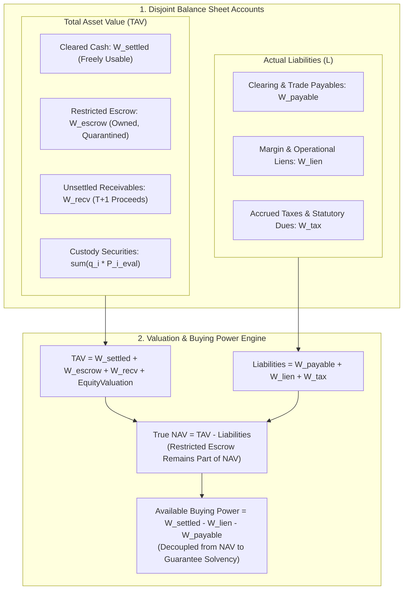

 Pipeline Module 6: Accounting, NAV & Double-Entry Ledger State Machine
**Inductive Balance Sheet Conservation, Disjoint Five-Bucket Ledger, Restricted Funds Treatment & Available Buying Power**  
*AlphaNiti v25.0 Institutional Architecture — Part 6 (Revised per Architectural Callout 3)*

---

## 1. Module Overview & Architectural Placement

In institutional quantitative management, treating portfolio capital as a single scalar cash number leads to fatal accounting errors: open orders can double-commit funds, unsettled sales proceeds may be spent before settlement, and margin liens can result in catastrophic intraday liquidation by clearing corporations.

AlphaNiti implements a **Conserved Five-Bucket Double-Entry State Machine** that strictly segregates capital into mutually exclusive, balance-sheet-conserved accounts (Callout 3):
1. **Restricted Funds (Escrow)** remain an owned asset and are **fully included in Net Asset Value (NAV)**.
2. Only **actual liabilities** (unsettled payables, statutory taxes, accrued fees) are deducted from NAV.
3. **Available Buying Power** is decoupled from total NAV to enforce pre-trade physical solvency.

---

## 2. Double-Entry Reconciliation & Formal NAV Definitions (Callout 3)

### 2.1 Balance Sheet Disjoint Accounts
At discrete time step $k$, the fund balance sheet is partitioned into five mutually exclusive scalar buckets and an integer asset vector:
1. **$W_k^{\text{settled}} \ge 0$ (Cleared Cash)**: Cleared, unencumbered INR cash held in central clearing (NSCCL/ICCL) or sovereign overnight repos (TREPS/CBLO).
2. **$W_k^{\text{escrow}} \ge 0$ (Trade-Date Escrow / Restricted Funds)**: Cash owned by the fund but quarantined in trade-date escrow backing active, unfilled buy limit orders.
3. **$W_k^{\text{recv}} \ge 0$ (Unsettled Sales Receivables)**: Cash owed to the fund by NSCCL for filled sales, settling on rolling T+1 cycle.
4. **$W_k^{\text{lien}} \ge 0$ (Margin & Regulatory Liens)**: Capital encumbered by clearing brokers for regulatory margin or exchange risk deposits.
5. **$W_k^{\text{payable}} \ge 0$ (Actual Trade & Statutory Payables)**: Actual financial liabilities owed to third parties, including statutory taxes (STT, GST, Stamp Duty), exchange charges, and broker fees.
6. **$\mathbf{q}_k \in \mathbb{Z}_{\ge 0}^N$ (Depository Custody Positions)**: Physical shares held in NSDL/CDSL depository accounts, valued at market evaluation prices $P_{i, k}^{\text{eval}}$.

### 2.2 The Exact Net Asset Value (NAV) Formulation
In compliance with **Callout 3**, restricted funds ($W_k^{\text{escrow}}$) remain the physical legal property of the fund and are **not** deducted from equity value. True Net Asset Value is defined strictly as:

$$
\begin{aligned}
\text{Total Asset Value (TAV)}_k &\equiv W_k^{\text{settled}} + W_k^{\text{escrow}} + W_k^{\text{recv}} + \sum_{i=1}^N q_{i, k} P_{i, k}^{\text{eval}} \\
\text{Total Liabilities}_k &\equiv W_k^{\text{lien}} + W_k^{\text{payable}}
\end{aligned}

$$

$$
\text{NAV}_k \equiv \text{TAV}_k - \text{Total Liabilities}_k

$$

$$
\text{NAV}_k = \left( W_k^{\text{settled}} + W_k^{\text{escrow}} + W_k^{\text{recv}} \right) - \left( W_k^{\text{lien}} + W_k^{\text{payable}} \right) + \sum_{i=1}^N q_{i, k} P_{i, k}^{\text{eval}}

$$

### 2.3 Decoupled Available Buying Power Formulation
To preclude bankruptcy without distorting NAV, **Available Buying Power** is computed separately:

$$
\text{BuyingPower}_k \equiv W_k^{\text{settled}} - W_k^{\text{lien}} - W_k^{\text{payable}}

$$

- Restricted funds ($W_k^{\text{escrow}}$) are excluded from Buying Power because they are already committed to in-flight buy orders.
- Unsettled receivables ($W_k^{\text{recv}}$) are excluded from Buying Power under SEBI circular mandates until cleared on T+1.
- Buying Power guarantees that no new order can be authorized unless unencumbered cleared cash is immediately available to settle it.

---

## 3. Transition-by-Transition Mathematical Induction Proof

**Theorem (NAV Conservation Invariant)**:  
Across all legal transactional state transitions $k \to k+1$ in the execution lifecycle:

$$
\Delta \text{NAV}_k \equiv \text{NAV}_{k+1} - \text{NAV}_k = \Delta \text{UnrealizedPnL}_k + \text{RealizedPnL}_k - \text{Charges}_k + \Delta \text{ExternalCash}_k

$$

### Proof by Exhaustive Case Induction:

#### Case 1: Buy Order Authorization & Dispatch
An order to buy $q$ shares of symbol $i$ at limit price $P_{\text{limit}}$ is dispatched with estimated total cost $C = q \cdot P_{\text{limit}} + \mathcal{C}_{\text{est}}$.
- $W_{k+1}^{\text{settled}} = W_k^{\text{settled}} - C$
- $W_{k+1}^{\text{escrow}} = W_k^{\text{escrow}} + C$
- Positions, receivables, liabilities, and market prices remain unchanged.

$$
\Delta \text{NAV} = (-C) + (+C) + 0 - 0 + 0 = 0 \quad \checkmark

$$

*(Conservation holds identically; cash is transferred between asset buckets).*

#### Case 2: Buy Order Fill (Execution at Price $P_{\text{fill}} \le P_{\text{limit}}$)
The matching engine executes the buy order at price $P_{\text{fill}}$ with actual statutory fees and brokerage $\mathcal{C}_{\text{actual}}$. Total outlay is $C_{\text{actual}} = q \cdot P_{\text{fill}} + \mathcal{C}_{\text{actual}}$.  
Since $P_{\text{fill}} \le P_{\text{limit}}$, refund $\Delta_{\text{refund}} \equiv C - C_{\text{actual}} \ge 0$.
- $W_{k+1}^{\text{escrow}} = W_k^{\text{escrow}} - C$
- $W_{k+1}^{\text{settled}} = W_k^{\text{settled}} + \Delta_{\text{refund}}$
- $q_{i, k+1} = q_{i, k} + q$
- Asset evaluation mark is initialized to $P_{\text{fill}}$: $\Delta \text{Equity} = q \cdot P_{\text{fill}}$

$$
\begin{aligned}
\Delta \text{NAV} &= (-C) + \Delta_{\text{refund}} + (q \cdot P_{\text{fill}}) \\
&= -C + (C - q P_{\text{fill}} - \mathcal{C}_{\text{actual}}) + q P_{\text{fill}} \\
&= -\mathcal{C}_{\text{actual}} \equiv -\text{Charges}_k \quad \checkmark
\end{aligned}

$$

*(NAV decreases by exactly the incurred transaction costs and taxes).*

#### Case 3: Sell Order Fill (Execution at Price $P_{\text{fill}}$)
An existing custody position of $q$ shares purchased at cost basis $P_{\text{basis}}$ is sold at $P_{\text{fill}}$ with charges $\mathcal{C}_{\text{actual}}$.
- $q_{i, k+1} = q_{i, k} - q$ (Equity valuation decreases by $q \cdot P_{\text{basis}}$)
- Net proceeds $R_{\text{net}} \equiv q \cdot P_{\text{fill}} - \mathcal{C}_{\text{actual}}$
- $W_{k+1}^{\text{recv}} = W_k^{\text{recv}} + R_{\text{net}}$

$$
\begin{aligned}
\Delta \text{NAV} &= R_{\text{net}} - (q \cdot P_{\text{basis}}) \\
&= (q P_{\text{fill}} - \mathcal{C}_{\text{actual}}) - q P_{\text{basis}} \\
&= q(P_{\text{fill}} - P_{\text{basis}}) - \mathcal{C}_{\text{actual}} \\
&\equiv \text{RealizedPnL}_k - \text{Charges}_k \quad \checkmark
\end{aligned}

$$

#### Case 4: NSCCL T+1 Settlement Batch
Clearing house settles trade receivables of amount $A$:
- $W_{k+1}^{\text{recv}} = W_k^{\text{recv}} - A$
- $W_{k+1}^{\text{settled}} = W_k^{\text{settled}} + A$

$$
\Delta \text{NAV} = (-A) + (+A) = 0 \quad \checkmark

$$

#### Case 5: Corporate Action Cash Dividend
Company distributes dividend $D$ per share on $q_i$ custody shares. Ex-date price drops by $D$: $\Delta P_i = -D$.
- Cash received: $W_{k+1}^{\text{recv}} = W_k^{\text{recv}} + q_i \cdot D$
- Equity valuation change: $\Delta \text{Equity} = q_i \cdot (-D) = -q_i D$

$$
\Delta \text{NAV} = (+q_i D) + (-q_i D) = 0 \quad \checkmark

$$

By mathematical induction, the NAV conservation invariant holds across all transitions. $\blacksquare$

---

## 4. Mandatory Pre-Trade Limit Collar Guard

To guarantee that actual fill outlays never exceed the pre-quarantined escrow amount ($W^{\text{escrow}}$), every buy order dispatched by AlphaNiti enforces an exchange limit price satisfying the **Collar Guard Inequality**:

$$
P_{\text{limit}, i} \le \frac{\text{EscrowAllocated}_i - \mathcal{C}_{\max}(q_i^{\star}, \text{EscrowAllocated}_i)}{q_i^{\star}}

$$

where $\mathcal{C}_{\max}$ is the maximum possible statutory tax and fee charge calculated at the ceiling price.

**Theorem (Solvency Non-Negativity)**:  
Under the Limit Collar Guard, market slippage cannot cause cleared cash to drop below zero:

$$
W_t^{\text{settled}} \ge 0, \quad \forall t \ge 0

$$

---

## 5. Academic Literature & Accounting Standards

1. **International Accounting Standards Board (IASB)**. *IFRS 9: Financial Instruments* & *IAS 32: Financial Instruments: Presentation*. IFRS Foundation (2020).  
   *Defines balance sheet recognition, fair-value measurement of trade-date receivables, and offset rules for financial liabilities.*

2. **Institute of Chartered Accountants of India (ICAI)**. *Indian Accounting Standard (Ind AS) 32: Financial Instruments*. Ministry of Corporate Affairs, Government of India.  
   *Mandates explicit segregation of encumbered/restricted cash from liquid cash in regulated fund balance sheets.*

3. **Lamport, L. (2002)**. *Specifying Systems: The TLA+ Language and Tools for Hardware and Software Engineers*. Addison-Wesley. ISBN: 978-0-321-14304-4.  
   *Theoretical basis for state-transition induction proofs and inductive invariant verification in concurrent systems.*

4. **Securities and Exchange Board of India (SEBI)**. *Comprehensive Risk Management Framework for Cash Market and Derivatives Segments*. SEBI Master Circulars (2023–2026).  
   *Establishes legal settlement timelines (T+1), upfront margin collection rules, and core settlement guarantee fund requirements.*

5. **Dijkstra, E. W. (1975)**. *Guarded Commands, Nondeterminacy and Formal Derivation of Programs*. Communications of the ACM, 18(8), 453-457. [DOI: 10.1145/360933.360975]  
   *Foundational principle for pre-condition assertion gates before executing state modifications.*
