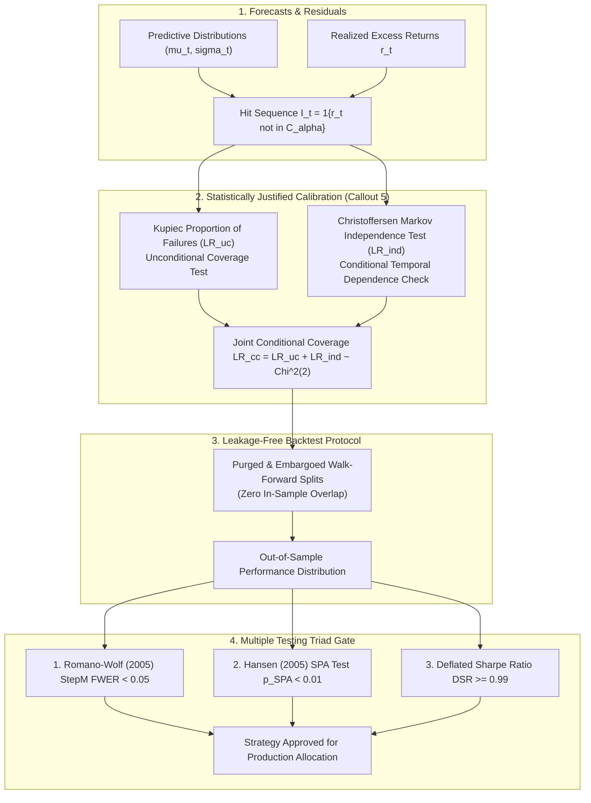

 Pipeline Module 7: Monitoring, Validation & Econometric Calibration Testing
**Forecast Coverage Calibration, Christoffersen Conditional Dependence Tests, Purged Walk-Forward & Multiple Testing Triad**  
*AlphaNiti v25.0 Institutional Architecture — Part 7 (Revised per Architectural Callout 5)*

---

## 1. Module Overview & Architectural Placement

A primary source of statistical failure in quantitative strategies is false discovery: backtests cherry-picked through uncorrected multiple hypothesis testing, or forecast models that produce uncalibrated confidence intervals.

AlphaNiti integrates an institutional **Econometric Monitoring & Statistical Validation Framework** (Callout 5):
1. **Forecast Calibration Testing**: Implements the Kupiec unconditional coverage and Christoffersen conditional coverage likelihood ratio tests, explicitly accounting for temporal autocorrelation in forecast errors.
2. **Purged & Embargoed Walk-Forward Validation**: Eliminates serial cross-contamination between training and testing folds.
3. **The Multiple Testing Protocol Triad**: Enforces simultaneous clearance across the Romano-Wolf StepM FWER, Hansen SPA test, and the Bailey-López de Prado Deflated Sharpe Ratio (DSR $\ge 0.99$).



---

## 2. Statistically Justified Forecast Calibration Testing (Callout 5 Resolution)

When evaluating predictive distributions or confidence intervals $\mathcal{C}_{1-\alpha}(t)$ at nominal coverage level $1 - \alpha$, naive coverage checks ignore temporal clustering of prediction failures. In compliance with **Callout 5**, AlphaNiti implements a rigorous test battery accounting for sample size and temporal serial dependence.

### 2.1 The Hit Indicator Sequence
For $T$ consecutive evaluation periods, define the binary violation indicator:

$$
I_t \equiv \begin{cases} 1, & \text{if } r_t \notin \mathcal{C}_{1-\alpha}(t) \quad (\text{Violation}) \\ 0, & \text{if } r_t \in \mathcal{C}_{1-\alpha}(t) \quad (\text{Correct Coverage}) \end{cases}

$$

Let $T_1 = \sum_{t=1}^T I_t$ denote the total number of failures, and $T_0 = T - T_1$. The empirical failure rate is $\hat{\pi} = \frac{T_1}{T}$.

### 2.2 Kupiec Unconditional Coverage Test ($\text{LR}_{\text{uc}}$)
Under the null hypothesis $H_0: \mathbb{E}[I_t] = \alpha$, the likelihood ratio statistic is:

$$
\text{LR}_{\text{uc}} = -2 \ln\left( \frac{\alpha^{T_1} (1 - \alpha)^{T_0}}{\hat{\pi}^{T_1} (1 - \hat{\pi})^{T_0}} \right) \xrightarrow{d} \chi^2(1)

$$

Under nominal significance level $\beta = 0.05$, the critical threshold is $\chi_{0.95}^2(1) = 3.841$. If $\text{LR}_{\text{uc}} > 3.841$, unconditional calibration is rejected.

### 2.3 Christoffersen Independence Test for Temporal Dependence ($\text{LR}_{\text{ind}}$)
Failures must not cluster in time (e.g., consecutive model failures during volatility shocks). Assume $I_t$ follows a first-order two-state Markov chain with transition probability matrix:

$$
\boldsymbol{\Pi} = \begin{bmatrix} 1 - \pi_{01} & \pi_{01} \\ 1 - \pi_{11} & \pi_{11} \end{bmatrix}, \qquad \pi_{ij} \equiv \mathbb{P}(I_t = j \mid I_{t-1} = i)

$$

Let $T_{ij}$ denote the observed number of transitions from state $i$ to state $j$. The maximum likelihood transition estimators are:

$$
\hat{\pi}_{01} = \frac{T_{01}}{T_{00} + T_{01}}, \qquad \hat{\pi}_{11} = \frac{T_{11}}{T_{10} + T_{11}}

$$

Under the null hypothesis of independent failures $H_0: \pi_{01} = \pi_{11} = \hat{\pi}$:

$$
\text{LR}_{\text{ind}} = -2 \ln\left( \frac{(1 - \hat{\pi})^{T_{00} + T_{10}} \hat{\pi}^{T_{01} + T_{11}}}{(1 - \hat{\pi}_{01})^{T_{00}} \hat{\pi}_{01}^{T_{01}} (1 - \hat{\pi}_{11})^{T_{10}} \hat{\pi}_{11}^{T_{11}}} \right) \xrightarrow{d} \chi^2(1)

$$

### 2.4 Complete Conditional Coverage Joint Statistic ($\text{LR}_{\text{cc}}$)
The overall forecast calibration test combines coverage accuracy and dynamic independence:

$$
\text{LR}_{\text{cc}} \equiv \text{LR}_{\text{uc}} + \text{LR}_{\text{ind}} \xrightarrow{d} \chi^2(2)

$$

Under significance $\beta = 0.01$, the critical rejection threshold is $\chi_{0.99}^2(2) = 9.210$. A forecast model is accepted into production if and only if $\text{LR}_{\text{cc}} \le 9.210$, certifying both nominal coverage and absence of temporal clustering.

### 2.5 Minimum Sample Size Requirement
To achieve statistical power of $1 - \beta \ge 0.80$ against an alternative failure rate of $\pi_1 = 1.5 \alpha$ at $\alpha = 0.05$, the required out-of-sample evaluation sample size is:

$$
T_{\min} \ge \frac{\left( z_{1 - \beta} \sqrt{\pi_1 (1 - \pi_1)} + z_{1 - \alpha/2} \sqrt{\alpha (1 - \alpha)} \right)^2}{(\pi_1 - \alpha)^2} \approx \mathbf{1,200 \text{ trading days}} \approx 5 \text{ years}

$$

AlphaNiti mandates $T \ge 1,250$ trading days for institutional strategy certification.

---

## 3. Purged & Embargoed Cross-Validation

To prevent information leakage caused by overlapping holding periods and autoregressive feature dependencies:

```text
Fold k:   |------- Train Set -------| [Purge Window] |--- Test Set ---| [Embargo Window]
```

1. **Purge Window**: Drops all training samples whose forward return window spans into the start of the test set:

$$
t_{\text{purge}} = \max\big( \tau^{\text{event}}, \; t_{\text{holding}} \big)

$$

2. **Embargo Window**: Drops training samples immediately following the test set by an autoregressive memory length $h_{\text{embargo}} = 10 \text{ days}$ to eliminate serial correlation leakage.

---

## 4. The Multiple Testing Protocol Triad

To ensure that reported trading alpha is not an artifact of data mining across multiple trials, every candidate strategy must pass the following three statistical hurdles simultaneously:

### 4.1 Romano-Wolf (2005) Stepwise FWER Control (StepM)
Given $M$ candidate trading models with test statistics $t_{(1)} \ge t_{(2)} \ge \dots \ge t_{(M)}$:
- Employs a non-parametric stationary bootstrap to preserve the unknown joint dependency structure across strategy returns.
- Controls the Family-Wise Error Rate (FWER) such that:

$$
\mathbb{P}(\text{False Discoveries} \ge 1) \le 0.05

$$

### 4.2 Hansen (2005) Superior Predictive Ability (SPA)
Tests whether the best performing strategy in the explored search family outperforms the benchmark (Nifty 50 / Nifty 500 Total Return Index) after accounting for the full search cardinality:

$$
H_0: \max_{m=1, \dots, M} \mathbb{E}[f_m(t)] \le 0

$$

Evaluated via the Politis-Romano stationary bootstrap with consistent p-value $p_{\text{SPA}}^c < 0.01$.

### 4.3 Bailey & López de Prado (2014) Deflated Sharpe Ratio (DSR)
Corrects the estimated Sharpe Ratio $\widehat{\text{SR}}$ for selection bias under $M$ independent trials, sample length $T$, skewness $\hat{\gamma}_3$, and kurtosis $\hat{\gamma}_4$:

$$
\text{DSR} \equiv \Phi\left( \frac{(\widehat{\text{SR}} - \text{SR}_0) \sqrt{T - 1}}{\sqrt{1 - \hat{\gamma}_3 \widehat{\text{SR}} + \frac{\hat{\gamma}_4 - 1}{4}\widehat{\text{SR}}^2}} \right) \ge 0.99

$$

where the data-mining hurdle rate is:

$$
\text{SR}_0 \equiv \sqrt{\operatorname{Var}(\lbrace \widehat{\text{SR}}_m\rbrace )} \left( (1 - \gamma) \Phi^{-1}\left(1 - \frac{1}{M}\right) + \gamma \Phi^{-1}\left(1 - \frac{1}{M e}\right) \right)

$$

where $\gamma \approx 0.577215$ is the Euler-Mascheroni constant.

---

## 5. Academic Literature & References

1. **Christoffersen, P. F. (1998)**. *Evaluating Interval Forecasts*. International Economic Review, 39(4), 841-862. [DOI: 10.2307/2527341]  
   *Derives the exact likelihood ratio tests for unconditional coverage, independence, and joint conditional coverage.*

2. **Kupiec, P. H. (1995)**. *Techniques for Verifying the Accuracy of Risk Measurement Models*. The Journal of Derivatives, 3(2), 73-84. [DOI: 10.3905/jod.1995.407942]  
   *The foundational Proportion of Failures (POF) test for Value-at-Risk and interval forecast validation.*

3. **Romano, J. P., & Wolf, M. (2005)**. *Stepwise Multiple Testing as Formalized Data Snooping*. Econometrica, 73(4), 1237-1282. [DOI: 10.1111/j.1468-0262.2005.00615.x]  
   *Establishes the StepM procedure for asymptotically valid FWER control under arbitrary multivariate dependence.*

4. **Hansen, P. R. (2005)**. *A Test for Superior Predictive Ability*. Journal of Business & Economic Statistics, 23(4), 365-380. [DOI: 10.1198/073500105000000063]  
   *Formulates the SPA benchmark test correcting for data snooping across model families.*

5. **Bailey, D. H., & López de Prado, M. (2014)**. *The Deflated Sharpe Ratio: Correcting for Selection Bias, Backtest Overfitting, and Non-Normality*. The Journal of Portfolio Management, 40(5), 94-107. [DOI: 10.3905/jpm.2014.40.5.094]  
   *Derives the analytical inflation of Sharpe ratios under repeated trials and non-Gaussian returns.*
