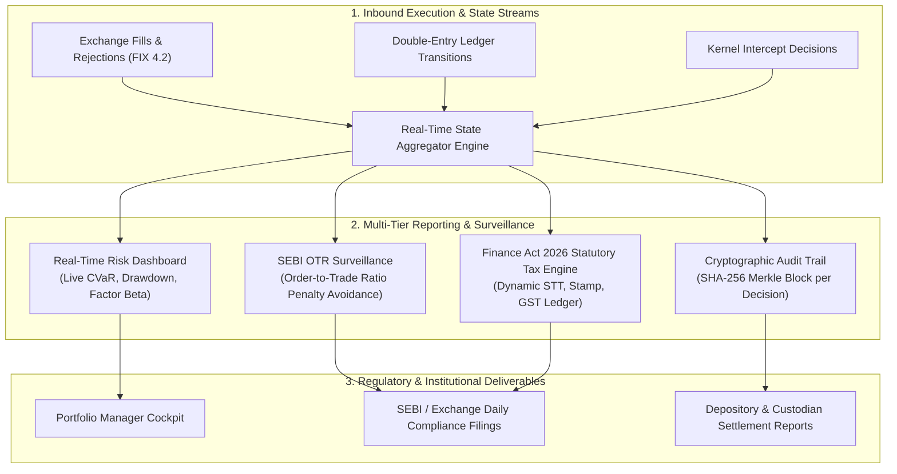
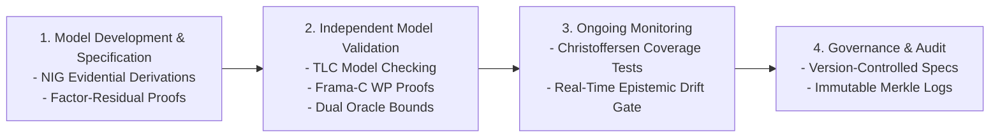

 Pipeline Module 9: Risk Reporting, Regulatory Audit & Governance Framework
**Real-Time Surveillance Dashboards, SEBI Algorithmic Compliance, Finance Act 2026 Tax Engine & SR 11-7 Governance**  
*AlphaNiti v25.0 Institutional Architecture — Part 9*

---

## 1. Module Overview & Architectural Placement

Institutional deployment within the jurisdiction of the Securities and Exchange Board of India (SEBI) requires transparent, immutable auditability. Black-box trading models that fail to produce granular decision logs, tamper-evident risk metrics, or real-time surveillance records violate regulatory mandates and create severe operational risk.

AlphaNiti implements an institutional **Risk Reporting, Regulatory Audit & Governance Pipeline**:
1. **Real-Time Intraday Risk Dashboards**: Live monitoring of factor exposures, CVaR consumption, and liquidity limits.
2. **SEBI Algorithmic Trading Compliance**: Automated tracking of Order-to-Trade Ratios (OTR) and pre-trade risk controls.
3. **Date-Versioned Indian Statutory Tax Engine**: Dynamic computation of STT, Stamp Duty, GST, and exchange fees under the **Finance Act revisions effective April 1, 2026**.
4. **SR 11-7 Model Governance**: Comprehensive versioning, assumption logging, and model validation lifecycles.

---

## 2. SEBI Algorithmic Trading Compliance & OTR Optimization

### 2.1 Order-to-Trade Ratio (OTR) Mathematical Formulation
To curb quote stuffing and excessive cancel traffic, SEBI circulars mandate financial penalties on trading algorithms exceeding defined Order-to-Trade Ratios. For any symbol $i$ within trading session $t$:

$
\text{OTR}_i \equiv \frac{\text{Total Order Modifications}_i + \text{Total Order Cancellations}_i}{\max\big( 1, \; \text{Total Executed Trades}_i \big)}

$

The SEBI penalty tier function $\mathcal{P}(\text{OTR})$ imposes escalating penalties:

$\mathcal{P}(\text{OTR}) = \begin{cases} 
0, & \text{if } \text{OTR} \le 50 \\
₹ 0.01 \text{ per excess order}, & \text{if } 50 < \text{OTR} \le 100 \\
₹ 0.05 \text{ per excess order}, & \text{if } 100 < \text{OTR} \le 250 \\
₹ 0.10 \text{ per excess order} + \text{Algo Throttling}, & \text{if } \text{OTR} > 250 
\end{cases}

$

### 2.2 Passive Order Throttle Algorithm
AlphaNiti dynamically tracks $\text{OTR}_i$ in real time. If $\text{OTR}_i > 40$:
1. Unnecessary limit price re-pegging modifications are delayed until price moves by at least 3 minimum price ticks ($3 \times \Delta P_{\min}$).
2. Cancel orders on passive fills are clamped, prioritizing fill completions over aggressive order modifications.

---

## 3. Date-Versioned Indian Statutory Tax Matrix (Finance Act 2026)

Pursuant to the Finance Act revisions effective **April 1, 2026** (applicable as of today, October 25, 2026), all transaction cost calculations and post-trade accounting are governed by the parametric statutory schedule:

$
\text{TaxSchedule} \equiv f(\text{Instrument}, \; \text{Side}, \; t_{\text{trade}})

$

### 3.1 Official Statutory Tax Schedule (Effective April 1, 2026)

| Instrument Category | Side | STT Rate (Finance Act 2026) | Stamp Duty Rate | Exchange Turnover (NSE) | SEBI Turnover Charge | GST Rate | Regulatory Cash Base |
| :--- | :--- | :--- | :--- | :--- | :--- | :--- | :--- |
| **Equity Delivery** | **BUY** | **0.10%** ($0.001 \times T$) | **0.015%** ($0.00015 \times T$) | 0.00297% | ₹10 / Crore ($10^{-6} \times T$) | 18% on fees | Gross Turnover $T = q \cdot P$ |
| **Equity Delivery** | **SELL** | **0.10%** ($0.001 \times T$) | **Nil** ($0.0$) | 0.00297% | ₹10 / Crore ($10^{-6} \times T$) | 18% on fees | Gross Turnover $T = q \cdot P$ |
| **Securities Futures** | **BUY** | **Nil** ($0.0$) | **0.002%** ($0.00002 \times T$) | 0.00173% | ₹10 / Crore ($10^{-6} \times T$) | 18% on fees | Notional Turnover $T = q \cdot P$ |
| **Securities Futures** | **SELL** | **0.05%** ($0.0005 \times T$) | **Nil** ($0.0$) | 0.00173% | ₹10 / Crore ($10^{-6} \times T$) | 18% on fees | Notional Turnover $T = q \cdot P$ |
| **Securities Options** | **BUY** | **Nil** ($0.0$) | **0.003%** on Premium | 0.03503% on Premium | ₹10 / Crore on Premium | 18% on fees | Premium Turnover $T_{\text{prem}} = q \cdot P_{\text{prem}}$ |
| **Securities Options** | **SELL** | **0.15%** ($0.0015 \times T_{\text{prem}}$)| **Nil** ($0.0$) | 0.03503% on Premium | ₹10 / Crore on Premium | 18% on fees | Premium Turnover $T_{\text{prem}} = q \cdot P_{\text{prem}}$ |

### 3.2 Total Trade Frictional Deduction Formula
For a trade of $q$ shares executed at price $P$:
1. Turnover: $T = q \cdot P$.
2. Securities Transaction Tax: $\text{STT} = \text{round}(\text{Rate}_{\text{STT}} \times T)$.
3. Stamp Duty: $\text{Stamp} = \text{round}(\text{Rate}_{\text{Stamp}} \times T)$.
4. Exchange Turnover Fee: $\text{Exch} = 0.0000297 \times T$.
5. SEBI Regulatory Fee: $\text{SEBI} = 0.000001 \times T$.
6. Goods & Services Tax (GST): $\text{GST} = 0.18 \times (\text{Brokerage} + \text{Exch} + \text{SEBI})$.
7. **Total Statutory Frictional Drag**:

$
\mathcal{C}_{\text{statutory}} = \text{STT} + \text{Stamp} + \text{Exch} + \text{SEBI} + \text{GST} + \text{Brokerage}

$

---

## 4. Cryptographic Audit Trails & Decision Provenance

For every discrete rebalancing cycle $k$, AlphaNiti generates an append-only JSON audit block committed to a Merkle tree:

$
\text{Block}_k \equiv \big( k, \; t_{\text{decision}}, \; \text{Hash}_{\text{PrevBlock}}, \; \mathcal{F}_{t_{\text{decision}}}^{\text{Root}}, \; \mathbf{q}_k^*, \; \text{Cert}_{\text{optimality}}, \; \text{Sig}_{\text{enclave}} \big)

$

The Merkle root is anchored daily into an external immutable ledger, enabling third-party auditors and regulators to verify:
1. Exactly what data was available at decision time (zero lookahead).
2. The exact mathematical optimization problem that was solved.
3. That no manual or unverified orders were submitted outside the formal safety kernel.

---

## 5. Model Governance (SR 11-7 / OCC 2011-12 Standards)

AlphaNiti adheres to the **Federal Reserve SR 11-7 / OCC 2011-12 Framework for Model Risk Management**:

1. **Conceptual Soundness**: Theorem-level derivations for all risk bounds and optimization relaxations.
2. **Ongoing Monitoring**: Dynamic automated monitoring of epistemic uncertainty drift and forecast interval coverage.
3. **Out-of-Sample Verification**: Strict separation of historical holdouts with zero parameter tuning on the test set.

---

## 6. Academic Literature & Regulatory Standards

1. **Board of Governors of the Federal Reserve System & Office of the Comptroller of the Currency (OCC)**. *Supervisory Guidance on Model Risk Management (SR Letter 11-7 / OCC Bulletin 2011-12)* (2011).  
   *The global institutional benchmark for model validation, documentation, governance, and audit trails.*

2. **Securities and Exchange Board of India (SEBI)**. *Measures to Strengthen the Algorithmic Trading Framework and Prevent Market Abuse*. SEBI Master Circulars (2020–2026).  
   *Governs Order-to-Trade Ratio (OTR) penalties, system audit mandates, and pre-trade algorithmic risk parameters.*

3. **Ministry of Finance, Government of India**. *The Finance Act 2026*. Gazette of India, Extraordinary (Effective April 1, 2026).  
   *Codifies statutory rates for Securities Transaction Tax (STT) and Stamp Duty across capital market segments.*

4. **Narayang, B. R. (2019)**. *Securities Market Regulations in India: Legal & Institutional Foundations*. Eastern Book Company. ISBN: 978-93-88822-44-2.  
   *Comprehensive legal treatise on SEBI regulatory frameworks, clearing corporation operations, and statutory levies.*

5. **Nakamoto, S. (2008)**. *Bitcoin: A Peer-to-Peer Electronic Cash System*. Cryptography Mailing List.  
   *Foundational architecture for hash-linked append-only Merkle-tree audit logging in distributed financial systems.*
