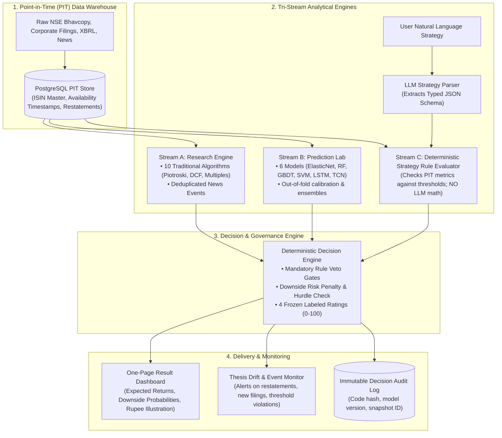

 AlphaNiti Architecture & Feasibility Validation Report
**Target Reviewer:** External AI Evaluator (ChatGPT) / Senior Quantitative Researcher / Principal ML Engineer  
**Project:** AlphaNiti — Indian Equity Research & Decision Workspace  
**Document Evaluated:** *AlphaNiti Project Research Plan and Algorithm Specification (Planning Version 0.1)*  
**Date of Audit:** October 2026  

---

## Executive Summary

This validation dossier provides a complete, structured analysis of the **AlphaNiti** project blueprint. AlphaNiti aims to automate the end-to-end investment research process for Indian cash equities (National Stock Exchange - NSE) over 20- and 60-day investment horizons. 

It attempts to unite:
1. **Fundamental and traditional quant screens** (DCF, Piotroski F-Score, Magic Formula, Momentum).
2. **Machine learning return & tail-risk forecasting** (ElasticNet, Tree ensembles, LSTMs, TCNs).
3. **Neuro-symbolic strategy parsing** (LLM-based natural language parsing converted into deterministic rule execution).
4. **Strict Point-in-Time (PIT) data integrity** and **SEBI compliance by design**.

This report highlights the **core architecture**, isolates **all unverified claims and speculative assumptions**, details **Indian equity market constraints**, and provides a **turnkey prompt and rubric for ChatGPT** to stress-test the proposal.

---

## 1. Project Blueprint & Architectural Specifications

### 1.1 Core Mission
To provide an interactive, single-page equity research workspace that delivers:
- Four frozen 0–100 labeled ratings (*Investment Quality*, *Forecast Strength*, *Strategy Fit*, *Overall Assessment*).
- Calibrated return forecasts, scenario ranges, and explicit Rupee gain/loss illustrations (e.g., net outcome on ₹1,00,000 invested).
- Explicit decision states (`Buy candidate`, `Hold`, `Avoid`, or `Insufficient evidence`) gated by mandatory user criteria and downside risk limits.

### 1.2 End-to-End System Topology



---

## 2. Red Flags & Unverified Hypotheses in the Specification

The original specification includes several placeholders and optimistic claims that must be aggressively vetted:

| Area | Stated Assumption / Claim | Validation Risk & Methodological Flaws |
| :--- | :--- | :--- |
| **News Signal** | Document mentions *"77 percent news directional accuracy"* as an internal project observation. | **High Risk:** Unrealistically high for equity markets. Likely suffers from lookahead bias, post-hoc labeling leakage, or bull-market base-rate drift. An accurately classified event does not imply predictable subsequent price movement. |
| **Historical Data** | Assumes 25 years of point-in-time NSE fundamentals and news. | **High Feasibility Risk:** Digital filing availability (XBRL/PDF) on NSE/BSE was highly fragmented prior to 2008–2010. Delisting, merger, and ticker-symbol history across Indian data providers often suffer from survivorship bias. |
| **Deep Sequence Models (LSTM, TCN)** | Deploys LSTM and Temporal Convolutional Networks alongside tabular models (GBDT, ElasticNet). | **High Overfitting Risk:** Asset pricing literature (e.g., Gu, Kelly, Xiu 2020) demonstrates that shallow trees and regularized linear models generally outperform recurrent deep models on monthly/quarterly equity returns due to high noise-to-signal ratios. |
| **Model Stacking & Ensembling** | Proposes testing three combination rules including meta-model stacking. | **Overfitting Risk:** Stacking models on financial time series without strict combinatorial purged cross-validation frequently collapses out-of-sample. |
| **Accounting Factor Transfer** | Direct application of US-derived formulas (Piotroski F-Score, Greenblatt Magic Formula). | **Domain Mismatch:** Indian accounting shifts (Indian GAAP to Ind AS in 2016) and differences in working capital, promoter share pledging, and BFSI reporting invalidate standard Compustat equations without localized adaptations. |
| **Strategy Parsing Safety** | Relies on an LLM to parse user investment criteria into structured rules. | **Prompt Injection / Semantic Drift:** Ambiguous user prompts (e.g., *"buy high-growth safe midcaps"*) can lead to malformed AST rules or arbitrary default threshold selections. |

---

## 3. Critical Technical & Domain Requirements (Indian Equities)

An evaluator must review the proposal against Indian market microstructure:

1. **Trade Execution & Friction Modeling:**
   - Must model day $t+1$ execution (Open or VWAP), not day $t$ Close.
   - Must account for statutory Indian friction: STT (Securities Transaction Tax), exchange turnover fees, SEBI charges, GST, stamp duty, and liquidity-dependent bid-ask spread.
2. **Circuit Limits & Liquidity Locks:**
   - Indian equities have daily price bands (2%, 5%, 10%, 20%) and regulatory surveillance frameworks (ASM / GSM). Models must handle locked-circuit days as non-tradable states.
3. **SEBI Regulatory Boundaries:**
   - Compliance with SEBI Master Circulars for **Research Analysts (RA)** vs. **Investment Advisers (IA)**. 
   - Personalized advice or execution triggers risk IA categorization. AlphaNiti must function as an **objective analytical workspace** (evidence + user-rule matching) rather than discretionary advisory.

---

## 4. Turnkey Prompt for External LLM (ChatGPT) Validation

Copy and paste the prompt below directly into **ChatGPT** (GPT-4o or o1-series) to conduct an independent, deep-dive peer review of the AlphaNiti proposal.

***

### 📋 COPY PROMPT BELOW THIS LINE 📋

```markdown
You are serving as a Senior Quantitative Portfolio Manager and Principal Financial Software Architect auditing a project specification called "AlphaNiti: Indian Equity Research and Personalized Decision Workspace".

### Project Overview:
AlphaNiti proposes an automated, point-in-time research platform for Indian listed cash equities (NSE) targeting 20- and 60-day holding horizons. Its architecture decouples into:
1. Point-in-Time Data Store: Dual timestamps (publication vs first availability), revision tracking, ISIN-based instrument master (including delistings/mergers).
2. Traditional Research Engine: 10 methods (DCF, Multiples, Magic Formula, Piotroski F-Score, Momentum, Turtle Breakout, EWMA, Historical Downside, Pairs z-score, Fractional Kelly) + classified news pipeline.
3. ML Prediction Lab: Tabular & sequence models (ElasticNet, Random Forest, GBDT, SVM, LSTM, TCN) predicting 20d/60d excess return and downside breach probability with out-of-fold calibration.
4. Neuro-Symbolic Strategy Engine: An LLM parses free-text investor rules into an Abstract Syntax Tree (JSON schema), which is then deterministically evaluated against verified point-in-time data (the LLM does zero arithmetic).
5. Deterministic Decision Core: Synthesizes evidence into 4 frozen 0–100 ratings (Investment Quality, Forecast Strength, Strategy Fit, Overall Assessment) with mandatory veto gates, outputting Buy candidate/Hold/Avoid/Insufficient Evidence and explicit rupee illustrations.
6. Indian Context: Tailored to NSE cash equities under SEBI regulatory guidelines.

### Your Audit Task:
Provide a rigorous, constructive, and uncompromising peer-review of this project. Structure your review into the following 6 sections:

#### Section 1: Quantitative & Methodological Rigor
- Critique the use of LSTMs and TCNs versus GBDT/ElasticNet on 20- and 60-day equity forecasts. Is deep learning justified here, or does it introduce catastrophic overfitting?
- Evaluate the purging/embargoing strategy for overlapping 20d and 60d return labels. What exact time-series validation protocols (e.g., Combinatorial Purged CV) are mandatory?
- Assess the validity of predicting a "calibrated probability of meeting a hurdle" on equity returns.

#### Section 2: Indian Equity (NSE) Microstructure & Data Reality
- Assess the feasibility and vendor availability of 25 years of true Point-in-Time fundamental and corporate action data for Indian listed companies. What are the specific pitfalls (Ind AS transition, promoter pledging, ASM/GSM surveillance, circuit bands)?
- Critique the assumption that corporate announcements and filings can be used immediately upon filing time. How must exchange broadcast delays and trading session cutoffs be treated?

#### Section 3: Neuro-Symbolic Strategy Architecture (LLM + Deterministic Engine)
- Evaluate the safety and reliability of using an LLM to compile natural language into executable investment rule schemas. 
- Where can this failure mode occur (ambiguous qualifiers, fuzzy metrics, edge cases)? 
- How should the formal grammar/AST be structured to ensure mathematical and logical immutability?

#### Section 4: SEBI Compliance & Regulatory Classification
- From a regulatory standpoint (SEBI Master Circulars for Research Analysts vs. Investment Advisers), does generating four scores, a decision state ('Buy candidate' / 'Avoid'), and a rupee gain/loss illustration cross the line from 'automated research tool' into 'regulated personalized investment advice'? 
- What architectural safeguards must be built to remain strictly compliant?

#### Section 5: True Novelty vs. Existing Open-Source (Qlib, OpenBB, FinRL)
- Does AlphaNiti present genuine scientific or architectural novelty, or is it a repackaging of standard quant tools?
- What specific components would make this platform publishable in top-tier applied quant finance or AI conferences (e.g., ICAIF, ACM SIGKDD)?

#### Section 6: Actionable Red-Team Verdict
- Give an explicit GO / NO-GO / PIVOT recommendation for the research phase.
- List the top 3 highest-priority experiments that the team must run in Week 1 before writing application code.
```
***

## 5. Review Checklist & Grading Rubric

When evaluating responses from ChatGPT or human reviewers, check if they address these non-negotiable benchmark standards:

- [ ] **Cross-Validation Strictness:** Did the review require **Purged Group Time-Series Split** or **Combinatorial Purged Cross-Validation (CPCV)** to prevent target overlap leakage over 20-day and 60-day horizons?
- [ ] **Accounting Shift Awareness:** Did the review identify the **Indian GAAP to Ind AS transition (FY2015-16)** as a major regime break in corporate financial statements?
- [ ] **Circuit Filter Execution:** Did the review emphasize that models cannot assume fills on stocks hitting upper or lower circuit limits (price freezes common in Indian mid/small caps)?
- [ ] **LLM Boundary Enforcement:** Did the review affirm that the LLM must **never touch pricing calculations or execution logic**, serving purely as an AST parser?
- [ ] **SEBI Distinction:** Did the review recognize the legal hazard of showing a *"Rupee outcome on a user-entered investment"* under SEBI Investment Adviser regulations?
